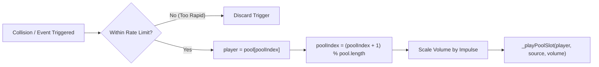
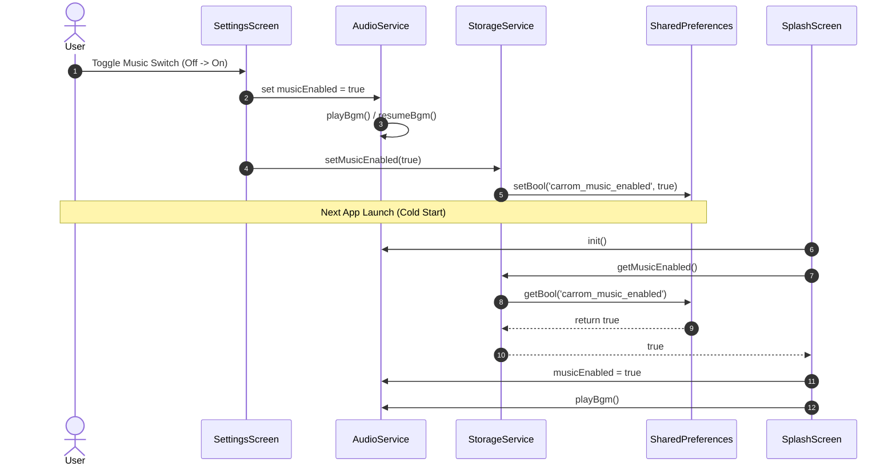

# Carrom Zone — Audio System Architecture, Logic & Flow Specification

This document provides a comprehensive technical reference for the audio, sound effects (SFX), background music (BGM), and contextual haptics engine in **Carrom Zone**. It details the architectural design, concurrency models, pooling mechanisms, rate-limiting algorithms, physics-to-audio calibration, lifecycle synchronization, and end-to-end integration flows across the game.

---

## 1. Executive Summary & Design Philosophy

Carrom Zone employs a tactile, authentic acoustic design that replicates the real-world physical experience of playing on a tournament-grade wooden carrom board:

1. **Acoustic Realism**: Sound effects are derived from authentic wooden coin impacts (`pieces_touch.mp3`) and pocket drops (`port.mp3`). Cushion/wall sounds are intentionally bypassed to prevent clutter and keep the acoustic environment focused on crisp coin-on-coin collisions.
2. **Zero Audio Lag (Low Latency)**: SFX use dedicated `PlayerMode.lowLatency` audio instances pre-loaded into memory to guarantee zero audible latency on physics collisions.
3. **Anti-Distortion Concurrency Pooling**: Rapid cluster collisions or multi-pocket events cycle through round-robin player pools (`_hitPool`, `_pocketPool`, `_uiTouchPool`) combined with millisecond-precision debounce thresholds to prevent channel clipping, audio stutter, or hardware buffer underruns.
4. **Contextual Audio-Haptic Co-location**: Haptic pulses are paired with sound events (such as Queen capture celebrations, foul alerts, and power pull-back thresholds) to provide multi-sensory physical feedback.
5. **Intelligent Lifecycle & Match State Ducking**: Background music plays during menus, collection screens, and splash screens, but automatically pauses during active gameplay matches so players can concentrate entirely on the board physics. Music resumes smoothly from the exact paused timestamp upon returning to the menu.

---

## 2. Audio Asset Manifest & Technical Specifications

| Asset Path | Format | Size | Bitrate / Specs | Role |
| :--- | :--- | :--- | :--- | :--- |
| `assets/audio/Carrom_Zone_BGM_50s_Loop.mp3` | MP3 | 801 KB | 44.1 kHz, Stereo, Seamless 50s loop | Background music in Menu, Settings, Splash, and Themes screens. |
| `assets/audio/pieces_touch.mp3` | MP3 | 25.4 KB | 44.1 kHz, Crisp wooden impulse | Piece-on-piece and striker-on-piece collision impact SFX. |
| `assets/audio/port.mp3` | MP3 | 17.9 KB | 44.1 kHz, Deep hollow pocket thud | Triggered when any carrom piece or striker drops into a pocket. |
| `assets/audio/touch_effect.mp3` | MP3 | 17.9 KB | 44.1 kHz, Subtle clean click | UI touch, card selection, button clicks, and tab switching. |
| `assets/audio/win.wav` | WAV | 53.0 KB | 44.1 kHz, 16-bit PCM, Melodic chime | Match victory fanfare and Queen cover success notification. |

---

## 3. Core Architecture (`AudioService`)

`AudioService` is implemented as a thread-safe Dart singleton integrated with Flutter's `WidgetsBindingObserver` to continuously track app state and system lifecycle transitions.

```
+----------------------------------------------------------------------------------+
|                               AudioService (Singleton)                           |
+----------------------------------------------------------------------------------+
| - State Flags: _initialized, _isBgmPlaying, _isGameplayActive, _isAppForeground  |
| - Independent Toggles: sfxEnabled, musicEnabled, hapticsEnabled                 |
+----------------------------------------------------------------------------------+
         |                                |                               |
         v                                v                               v
+------------------+            +------------------+            +------------------+
|  BGM Subsystem   |            |   SFX Engine     |            |  Haptics Engine  |
+------------------+            +------------------+            +------------------+
| - _bgmPlayer     |            | - _hitPool [5]   |            | - HapticFeedback |
| - MediaPlayer    |            | - _pocketPool [3]|            | - Light, Medium, |
| - Loop Release   |            | - _uiTouchPool[3]|            |   Heavy, Foul,   |
| - Vol: 0.28      |            | - Low Latency    |            |   Celebration    |
+------------------+            +------------------+            +------------------+
```

### 3.1 Subsystem Components

1. **Background Music Subsystem**:
   - Backed by `_bgmPlayer` running in `PlayerMode.mediaPlayer` with `ReleaseMode.loop`.
   - Default master volume calibrated to `0.28` to maintain a calm, non-fatiguing ambiance.
   - Supports non-destructive pausing (`pauseBgm()`) and resuming (`resumeBgm()`) preserving track playback position.
2. **SFX Concurrency Pools**:
   - Pre-allocated ring buffers of `AudioPlayer` instances in `PlayerMode.lowLatency`.
   - Pre-buffered with cached `Source` instances at initialization to eliminate runtime URL recreation and startup latency.
   - Uses `_playPoolSlot` which cleanly halts previous playback and invokes `play(source, volume: volume)` rather than fragile unawaited `seek(Duration.zero)` calls.
3. **Contextual Haptics Engine**:
   - Implements rate-limited tactile feedback via `HapticFeedback` services (`lightImpact`, `mediumImpact`, `heavyImpact`, `selectionClick`).
   - Includes custom multi-pulse sequences for complex game events (e.g., fouls and victory celebrations).

---

## 4. Concurrency Model & Player Pool Management

Carrom physics simulations can yield dozens of simultaneous circle-to-circle collision checks per second. Reusing a single player instance causes existing sounds to instantly cut off; conversely, instantiating new `AudioPlayer` objects on demand creates memory churn and audio stutter.

To solve this, `AudioService` uses a **fixed-size ring-buffer player pool**:



### 4.1 Pool Sizes & Latency Configurations

| Pool Name | Instance Count | Assigned Asset | Volume Master | Target Events |
| :--- | :--- | :--- | :--- | :--- |
| `_hitPool` | **5 Players** | `pieces_touch.mp3` | `0.90` (scaled dynamically) | Rapid successive coin-coin and striker-coin bounces. |
| `_pocketPool` | **3 Players** | `port.mp3` | `0.95` | Simultaneous or rapid multi-piece pocketing (including striker pocket). |
| `_uiTouchPool` | **3 Players** | `touch_effect.mp3` | `0.75` | Fast menu button presses, toggles, and slider clicks. |
| Dedicated Shoot | **1 Player** | `touch_effect.mp3` | `0.70` | Striker flick / launch cue. |
| Dedicated Win | **1 Player** | `win.wav` | `0.95` | Match victory fanfare and Queen cover success notification. |
| Dedicated Foul | **1 Player** | `touch_effect.mp3` | `0.85` | Foul alert audio cue paired with `hapticFoul()`. |

---

## 5. Rate Limiting & Anti-Distortion Throttling

When multiple pieces break from the center circle flower formation, physics engines can generate multiple collision events across consecutive sub-steps. Playing all of them produces acoustic distortion; however, throttling too aggressively drops legitimate follow-up carom hits.

`AudioService` enforces **precisely calibrated millisecond debounce throttling**:

```dart
// Minimum interval thresholds between identical sound types
static const int _minHitIntervalMs = 20;     // 20ms: Allows consecutive frame collisions (~16-33ms) while debouncing intra-substep duplicate impulses
static const int _minPocketIntervalMs = 20;  // 20ms: Allows distinct rapid multi-pocketing events while preventing duplicate triggers
static const int _minUiTouchIntervalMs = 50; // 50ms: Clean debounce for fast tapping
static const int _minHapticIntervalMs = 90;  // 90ms: Physical motor recovery interval
```

### Safe Playback Algorithm

```dart
Future<void> _playPoolSlot(
  AudioPlayer player,
  Source source, {
  required double volume,
}) async {
  try {
    if (player.state == PlayerState.playing) {
      await player.stop();
    }
    await player.setVolume(volume);
    await player.play(source, volume: volume);
  } catch (_) {
    try {
      await player.play(source, volume: volume);
    } catch (_) {}
  }
}
```

---

## 6. Physics Impulse to Volume Scaling

In `carrom_physics.dart`, elastic collisions calculate an exact mathematical impulse magnitude:

$$J = -\frac{(1 + e) \cdot v_{\text{rel}} \cdot n}{\frac{1}{m_A} + \frac{1}{m_B}}$$

This impulse value is forwarded to the game layer via collision callbacks. The game screen translates the physical collision strength into an audio volume multiplier using progressive square-root scaling:

```dart
// In lib/screens/game_screen.dart:
onDetailedPieceCollision: (impulse, typeA, typeB) {
  final bool isStrikerCoin = (isAStriker && isBValidCoin) || (isBStriker && isAValidCoin);
  final bool isCoinCoin = isAValidCoin && isBValidCoin;
  if (!isStrikerCoin && !isCoinCoin) return;

  // Audible threshold: 0.35 impulse captures gentle touches and deflections,
  // while ignoring imperceptible micro-vibrations between resting pieces.
  if (impulse >= 0.35) {
    final double normalized = ((impulse - 0.35) / 8.0).clamp(0.0, 1.0);
    final double volScale = 0.35 + 0.65 * math.sqrt(normalized);
    AudioService().playPieceCollision(volumeScale: volScale);
  }
};
```
  if (impulse > 0.4) { // Ignore imperceptible micro-vibrations
    // Maps collision impulse (0.4 to 12.0+) linearly to volume scale (0.25 to 1.0)
    final double volScale = (impulse / 12.0).clamp(0.25, 1.0);
    AudioService().playPieceCollision(volumeScale: volScale);
  }
};
```

### Impulse Mapping Curve

| Physical Impact | Impulse Range ($J$) | Calculated Volume | Acoustic Perception |
| :--- | :--- | :--- | :--- |
| Micro-settle / drift | $< 0.4$ | *Muted* | None (prevents background noise). |
| Light graze / deflection | $0.4 - 2.0$ | $0.15 - 0.25$ | Subtle, soft wooden contact. |
| Moderate tactical shot | $2.0 - 6.0$ | $0.35 - 0.55$ | Standard solid carrom click. |
| Direct hard strike | $6.0 - 12.0$ | $0.55 - 0.85$ | Loud, sharp tournament strike. |
| Maximum power break | $> 12.0$ | $0.85 - 1.00$ | Full impact resonance. |

---

## 7. Application Lifecycle & Match State Synchronization

A critical requirement of the audio system is clean state transitions between the OS lifecycle, navigation menus, and in-game matches.

```mermaid
stateDiagram-v2
    [*] --> Splash: App Startup
    Splash --> MainMenu: Assets Preloaded
    MainMenu --> InMatch: Player Starts Match
    InMatch --> PausedInGame: Tap Pause
    PausedInGame --> InMatch: Tap Resume
    InMatch --> MainMenu: Match Ends / Return
    MainMenu --> Backgrounded: User Minimizes App
    Backgrounded --> MainMenu: User Restores App
    InMatch --> Backgrounded: Minimize During Game
    Backgrounded --> InMatch: Restore During Game

    state Splash {
        BGM: Playing (Loop)
    }
    state MainMenu {
        BGM: Playing (Loop)
    }
    state InMatch {
        BGM: Paused (Ducked)
        SFX: Active (Physics & Pockets)
    }
    state PausedInGame {
        BGM: Paused
        SFX: Muted
    }
    state Backgrounded {
        BGM: Paused (Hard Stop)
        SFX: Muted
    }
```

### 7.1 Lifecycle Rules Matrix

| App State | Match State | `musicEnabled` | BGM Status | SFX Status |
| :--- | :--- | :--- | :--- | :--- |
| **Foreground** | Menu / Splash / Settings | `true` | **PLAYING** (volume 0.28) | Enabled |
| **Foreground** | Menu / Splash / Settings | `false` | **PAUSED** | Enabled (if `sfxEnabled`) |
| **Foreground** | Active Match (`setGameplayActive(true)`) | Any | **PAUSED** (Focus on match) | **ACTIVE** (Physics driven) |
| **Foreground** | In-Game Pause Dialog | Any | **PAUSED** | Paused |
| **Background** | Any (`inactive` / `paused` / `detached`) | Any | **PAUSED** | **MUTED** (`stopAllSfx()`) |

---

## 8. Contextual Haptic Feedback Logic

Haptics are coupled with sound events to reinforce tactile feedback. When `hapticsEnabled` is true, the following patterns execute:

```
[Touch / Button Tap]  ---> HapticFeedback.selectionClick() (60ms throttle)
[Slider Nudge / Aim]  ---> HapticFeedback.lightImpact()    (90ms throttle)
[Turn Change]         ---> HapticFeedback.lightImpact()
[Piece Pocketed]      ---> HapticFeedback.mediumImpact()
[Queen Pocketed]      ---> HapticFeedback.heavyImpact()
[Striker Foul]        ---> Multi-Pulse: Heavy (t=0ms) ===> Heavy (t=90ms)
[Queen Cover / Win]   ---> Cascade: Heavy (t=0ms) ===> Medium (t=120ms) ===> Light (t=240ms)
```

### Multi-Pulse Implementation (`hapticCelebration` & `hapticFoul`)

```dart
void hapticCelebration() {
  if (!hapticsEnabled) return;
  try {
    HapticFeedback.heavyImpact();
    Future.delayed(const Duration(milliseconds: 120), () {
      if (hapticsEnabled) HapticFeedback.mediumImpact();
    });
    Future.delayed(const Duration(milliseconds: 240), () {
      if (hapticsEnabled) HapticFeedback.lightImpact();
    });
  } catch (_) {}
}

void hapticFoul() {
  if (!hapticsEnabled) return;
  try {
    HapticFeedback.heavyImpact();
    Future.delayed(const Duration(milliseconds: 90), () {
      if (hapticsEnabled) HapticFeedback.heavyImpact();
    });
  } catch (_) {}
}
```

---

## 9. Comprehensive API Reference

### 9.1 Background Music Controls

| Method | Parameters | Preconditions | Behavior |
| :--- | :--- | :--- | :--- |
| `init()` | `none` | Called once in `SplashScreen`. | Registers lifecycle observer, pre-allocates audio pools, sets sources and low-latency modes. |
| `playBgm()` | `none` | `musicEnabled == true`, in menu. | Starts or resumes BGM loop at 0.28 volume. |
| `pauseBgm()` | `none` | Any | Pauses BGM playback preserving track position. |
| `resumeBgm()` | `none` | `musicEnabled == true`, app foreground. | Resumes BGM without restarting from beginning. |
| `stopBgm()` | `none` | Any | Hard stop; resets playback to 0:00. |

### 9.2 Gameplay & State Notifiers

| Method | Parameters | Trigger Source | Behavior |
| :--- | :--- | :--- | :--- |
| `setGameplayActive(bool active)` | `bool active` | `GameScreen.initState()` / `dispose()` | When `true`, automatically pauses BGM. When `false`, resumes BGM. |
| `setGameplayPaused(bool paused)` | `bool paused` | In-game pause menu | Maintains BGM pause state during active game sessions. |
| `stopAllSfx()` | `none` | App minimize / screen transition | Immediately halts playback across all 7 SFX players. |
| `stopAll()` | `none` | Logout / full reset | Halts all SFX and stops BGM. |

### 9.3 Sound Effect Triggers

| Method | Scaling / Parameters | Primary Caller | Description |
| :--- | :--- | :--- | :--- |
| `playUiTouch()` | None | UI buttons, tabs, dialogs | Plays `touch_effect.mp3` from `_uiTouchPool`. |
| `playHit({double volumeScale})` | `0.15` to `1.0` | `GameScreen` collision callback | Plays `pieces_touch.mp3` scaled by collision impulse. |
| `playPieceCollision()` | `volumeScale` | `GameScreen` | Alias for `playHit()`. |
| `playPocket()` | None | `GameScreen` pocket callback | Plays `port.mp3` from `_pocketPool`. |
| `playQueenPocket()` | None | `GameScreen` | Calls `playPocket()` + `hapticHeavy()`. |
| `playQueenCover()` | None | `GameScreen` rule engine | Plays `win.wav` at volume 0.90 + `hapticCelebration()`. |
| `playFoul()` | None | Striker pocket or penalty | Plays `_foulPlayer` + `hapticFoul()`. |
| `playWin()` | None | `GameOverDialog` (Winner) | Plays victory chime + `hapticCelebration()`. |
| `playDefeat()` | None | `GameOverDialog` (Loser) | Plays defeat haptic feedback. |

---

## 10. Persistence & Settings Storage Flow

Settings changes made in `SettingsScreen` update both `AudioService` in-memory state and `SharedPreferences` via `StorageService`:



---

## 11. Maintenance, Debugging & Best Practices

1. **Adding New Sound Assets**:
   - Place the compressed MP3/WAV file inside `assets/audio/`.
   - Register the file path in `pubspec.yaml` under `assets:`.
   - In `AudioService.init()`, pre-assign the player mode (`lowLatency` for SFX, `mediaPlayer` for music) and call `setSource(AssetSource(...))`.
2. **Preventing Audio Memory Leaks**:
   - `AudioService.dispose()` must only be called on application shutdown.
   - Individual screens (`GameScreen`, `MenuScreen`) must call `AudioService().setGameplayActive(false)` rather than disposing of the service.
3. **Unit & Integration Testing**:
   - In Flutter unit/widget tests, mock the `xyz.luan/audioplayers.global` and `xyz.luan/audioplayers` binary messenger channels, or set `AudioService().sfxEnabled = false` and `AudioService().hapticsEnabled = false` in `setUp()` to allow silent headless test execution.
