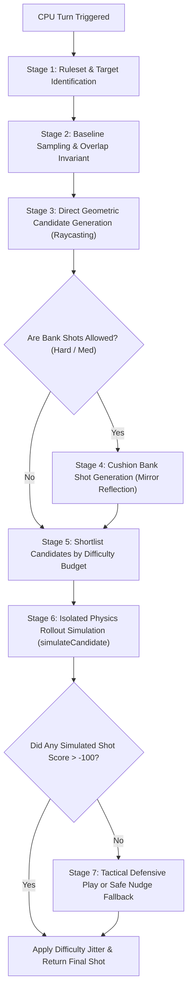

# 🤖 CARROM ZONE — BOT / CPU AI ENGINE & DIFFICULTY SPECIFICATION

> **Document Version:** 2.2.0 (Pre-Match Difficulty Dialog & AI Balancing Edition)  
> **Source Module:** [`lib/ai/carrom_ai.dart`](file:///c:/Users/Entire/Downloads/CarromMaster-main/CarromMaster-main/lib/ai/carrom_ai.dart)  
> **Supporting Modules:** [`lib/core/carrom_rule_engine.dart`](file:///c:/Users/Entire/Downloads/CarromMaster-main/CarromMaster-main/lib/core/carrom_rule_engine.dart), [`lib/core/turn_timer_controller.dart`](file:///c:/Users/Entire/Downloads/CarromMaster-main/CarromMaster-main/lib/core/turn_timer_controller.dart), [`lib/screens/game_screen.dart`](file:///c:/Users/Entire/Downloads/CarromMaster-main/CarromMaster-main/lib/screens/game_screen.dart), [`lib/screens/menu_screen.dart`](file:///c:/Users/Entire/Downloads/CarromMaster-main/CarromMaster-main/lib/screens/menu_screen.dart)  
> **Engine:** Deterministic 2D Physics-Based Predictive AI  
> **Supported Rulesets:** Classic Carrom (Casual Points) & Freestyle Points Mode  
> **Supported Difficulties:** Easy (Novice), Medium (Club Player), Hard (Tournament Pro)  
> **Target Decision Latency:** $< 10\text{ms}$ per full 19-piece board rollout

---

## 📑 TABLE OF CONTENTS

1. [Executive Overview & Design Philosophy](#1-executive-overview--design-philosophy)
2. [Dual-Ruleset AI Architecture](#2-dual-ruleset-ai-architecture)
   - 2.1 Classic Carrom Ruleset Strategy
   - 2.2 Freestyle Points Mode Strategy (10 / 20 / 50 Pts)
3. [AI Decision Pipeline (Step-by-Step Flow)](#3-ai-decision-pipeline-step-by-step-flow)
4. [Difficulty Levels & Rebalancing Matrix](#4-difficulty-levels--rebalancing-matrix)
   - 4.1 Parameter Comparison Table
   - 4.2 Easy Mode (Novice / Casual Friendly)
   - 4.3 Medium Mode (Balanced Club Player)
   - 4.4 Hard Mode (Tournament Champion)
5. [CPU Turn Pacing & Ludo Star-Style Countdown Integration](#5-cpu-turn-pacing--ludo-star-style-countdown-integration)
   - 5.1 Dynamic Thinking & Aim Dwell Timings
   - 5.2 Visual Aim Trajectory & Power Gauge Projection
   - 5.3 20-Second Shot Clock & Timeout Fallback
6. [Mathematical & Geometric Principles](#6-mathematical--geometric-principles)
   - 6.1 Baseline Striker Positioning & Overlap Invariant
   - 6.2 Ghost Ball Impact Point Calculation
   - 6.3 Cut Angle Thresholding (`minCosTheta`)
   - 6.4 Raycast Obstacle & Line-of-Sight Detection
   - 6.5 Cushion Bank Shot Mirror Reflection Math
   - 6.6 2D Momentum Transfer Launch Power Derivation
7. [Physics Rollout Simulation (`_simulateCandidate`)](#7-physics-rollout-simulation-_simulatecandidate)
   - 7.1 Deep State Cloning & Zero-Mutation Sandbox
   - 7.2 Bounded Settlement Horizon & Watchdog
   - 7.3 Ruleset-Aware Scoring Matrix & Evaluation
8. [Tactical Defensive Play & Safe Fallback](#8-tactical-defensive-play--safe-fallback)
9. [Automated Verification & Performance Benchmarks](#9-automated-verification--performance-benchmarks)

---

## 1. EXECUTIVE OVERVIEW & DESIGN PHILOSOPHY

In **Carrom Zone**, the Bot/CPU is engineered as a **deterministic, physics-driven agent** rather than a scripted "rubber-band" AI or an omniscient trigonometric cheat. 

### Core Architectural Principles:
- **Identical Physics & Rules:** The AI operates under the **exact same physical and regulatory constraints** as a human player:
  - It places the striker strictly along its baseline ($Y = -142.0$ virtual units for Black).
  - It cannot place the striker on top of overlapping pieces (`_generateBaselinePositions`).
  - It cannot apply arbitrary spin, telekinesis, or launch power exceeding `GameConfig.strikerMaxPower`.
  - It is evaluated by the authoritative `CarromTurnEvaluator` for fouls, dues, Queen covers, and match points.
- **Forward-Simulated Rollouts:** Rather than guessing whether a shot will pocket a coin, the AI clones the board and **actually simulates the shot inside an isolated `CarromPhysics` instance** to observe whether the coin drops, whether secondary deflections occur, and whether the striker scratches (fouls).
- **Ruleset Adaptability:** The AI intelligently pivots its target selection, Queen cover behavior, and heuristic fitness evaluation depending on whether the active match is **Classic Carrom** or **Freestyle Points Mode**.
- **Human-Like Pacing:** The CPU does not fire instantaneously. It simulates human cognition with variable thinking time and dwell time, projecting an aiming line and power ring visible to the human opponent before flicking.

---

## 2. DUAL-RULESET AI ARCHITECTURE

### 2.1 Classic Carrom Ruleset Strategy
Under `CarromRuleset.classic`:
- **Color Ownership:** Bot targets exclusively its assigned color (`PieceType.black` when playing as Black).
- **Point Values:** Each potted piece is $+1$ pt; Queen is $+3$ pts upon successful cover.
- **Queen Strategy:**
  - *Cover Needed (`needsQueenCover == true`):* Focuses strictly on potting any available Black coin.
  - *Queen Available & Uncovered:* 
    - When 1 own piece remains on board (Endgame): **Must target Queen first** to prevent premature 9-piece clearance respot infringements.
    - When 2 to 4 own pieces remain (Mid-Game): Actively contests Queen ($+3$ pt incentive).
    - When 5+ own pieces remain (Early-Game): Opens clusters and own pieces first; Queen is secondary.
- **Opponent Avoidance:** Opponent pieces are treated as obstacles or defensive hazards. Accidentally pocketing an opponent piece incurs a $-180.0$ fitness penalty.

### 2.2 Freestyle Points Mode Strategy (10 / 20 / 50 Pts)
Under `CarromRuleset.freestyle`:
- **Universal Piece Eligibility:** Both players can pocket ANY normal coin. Points belong to whoever pockets the coin regardless of color.
- **Scoring Weights:**
  - White Coin = $+10$ points
  - Black Coin = $+20$ points
  - Red Queen = $+50$ points (after valid cover)
- **Heuristic Target Prioritization:**
  - The AI candidate target pool orders available normal coins by point value: **Black ($20$ pts) ahead of White ($10$ pts)**.
  - In direct geometric scoring: Queen yields $+32.0$ bonus, Black yields $+18.0$, and White yields $+8.0$.
  - In cushion bank shots: Queen yields $+24.0$ bonus, Black yields $+14.0$, and White yields $+6.0$.
- **Queen Cover with Any Normal Coin:**
  - When `needsQueenCover == true`, the Bot can cover the Queen with **either White or Black normal coins**, choosing the easiest path to secure the $+50$ Queen reward.
  - If $\le 2$ normal pieces remain on the board while Queen is still uncovered, the Bot targets the Queen first to prevent board exhaustion deadlock.
- **Freestyle Fitness Scaling:**
  - Net score delta is scaled by $22.0$ per point (reflecting the 10/20/50 scale vs 1-pt Classic scale).
  - Crossing or reaching the target score ($160$ pts) awards a $+500.0$ match victory bonus.

---

## 3. AI DECISION PIPELINE (STEP-BY-STEP FLOW)

When `CarromAI.calculateShot()` is invoked, it executes seven deterministic stages:



### Pipeline Details:
1. **Target Identification:** Identifies candidate targets according to active ruleset (own pieces in Classic; all normal coins + Queen in Freestyle).
2. **Baseline Sampling:** Samples valid baseline coordinates $[-65.0, +65.0]$ with safety margin, rejecting any X coordinate where the striker overlaps a board coin ($d < r_s + r_p - 0.5$).
3. **Direct Raycasting:** Calculates the exact geometric contact point required to deflect the target coin into each of the 4 corner pockets.
4. **Cushion Bank Raycasting:** For Hard (and Medium when direct candidates $< 3$), calculates single-cushion bank shots using virtual mirror reflection across the left and right rails.
5. **Shortlist Pruning:** Heuristically ranks candidate shots and shortlists the top candidates according to difficulty simulation budget ($N = 2, 4,\text{ or } 6$).
6. **Isolated Physics Rollout:** Executes a sandbox sub-stepped physics simulation of each shortlisted shot until pieces come to complete rest.
7. **Difficulty Calibration & Output:** Selects the best physically verified shot and applies calibrated angular and power jitter corresponding to the selected difficulty tier.

---

## 4. DIFFICULTY LEVELS & REBALANCING MATRIX

### 4.1 Parameter Comparison Table

| Parameter | Easy (Novice) | Medium (Club Player) | Hard (Master / Pro) |
|:---|:---:|:---:|:---:|
| **Simulation Budget** | **2 Candidates** | **3 Candidates** | **5 Candidates** |
| **Cut Angle Limit (`minCosTheta`)** | **$0.52$** ($\le 58.7^\circ$, direct pots only) | **$0.38$** ($\le 67.7^\circ$, achievable cuts) | **$0.16$** ($\le 80.8^\circ$, tournament cuts) |
| **Angular Jitter Spread** | $\approx 10.0^\circ$ ($\pm 5.0^\circ$ base) | $\approx 4.7^\circ$ ($\pm 2.35^\circ$ base, scaled by difficulty) | $\approx 0.86^\circ$ ($\pm 0.43^\circ$ base) |
| **Power Variation** | $80\% - 120\%$ ($\pm 20.0\%$) | $90\% - 110\%$ ($\pm 10.0\%$) | $98\% - 102\%$ ($\pm 2.0\%$) |
| **Second Best Candidate Chance** | **$45\%$** | **$35\%$** | **$0\%$** (Always #1) |
| **Cushion Bank Shots** | **Disabled** | **Disabled** (Direct pots only) | **Full Cushion Bank Search** |
| **Tactical Defense (Pocket Denial)**| **Disabled** | **Disabled** (Non-punitive) | **Aggressive pocket denial** |
| **Shot-Difficulty Scaling** | Up to $2.0\times$ on long cuts | Up to $2.0\times$ on long cuts | Tight ($1.0 - 1.25\times$) |
| **Thinking Time** | $900\text{ms} - 1500\text{ms}$ | $600\text{ms} - 1100\text{ms}$ | $400\text{ms} - 800\text{ms}$ |
| **Aim Dwell Time** | $500\text{ms} - 800\text{ms}$ | $350\text{ms} - 600\text{ms}$ | $250\text{ms} - 450\text{ms}$ |
| **Decision Time (avg)** | $\approx 2.5\text{ms}$ | $\approx 4.2\text{ms}$ | $\approx 6.8\text{ms}$ ($< 10\text{ms}$) |

---

### 4.2 Easy Mode (Novice / Casual Friendly)
- **Goal:** Beginner-friendly tabletop opponent that is enjoyable and beatable without artificial, jarring mistakes.
- **Cut Angle Restriction:** Discards cuts exceeding $58.7^\circ$ (`cosTheta < 0.52`). Only attempts obvious, direct shots.
- **No Trick Shots:** Completely disables cushion bank shots.
- **Natural Variance:** Adds realistic angular spread ($\approx 10.0^\circ$ total arc) and launch power variance ($80\% - 120\%$).
- **Limited Queen Planning:** Focuses on own coins first; only contests Queen when required in late game.

### 4.3 Medium Mode (Balanced Club Player)
- **Goal:** A balanced, authentic, and enjoyable club player experience.
- **Achievable Cuts:** Restricts cut angles to $\le 67.7^\circ$ (`cosTheta < 0.38`), eliminating unrealistic razor-thin cuts.
- **Direct Play:** Cushion bank shots and defensive pocket-denial are disabled, keeping the board open and gameplay engaging.
- **Dynamic Difficulty-Scaled Jitter:** Base jitter is tuned to $\pm 2.35^\circ$ for clean execution on close straightforward shots, scaling naturally up to $2.0\times$ on long cuts to make difficult shots less reliable without artificial misses.
- **Imperfect Candidate Selection:** $35\%$ probability to select the second-best candidate, preventing robotic repetition.
- **Controlled Queen Contesting:** Focuses on standard pieces early/mid game; contests Queen when $\le 2$ pieces remain.

### 4.4 Hard Mode (Tournament Champion)
- **Goal:** Formidable, tournament-grade tactical opponent.
- **Extreme Cuts:** Evaluates thin cut shots up to $80.8^\circ$ (`cosTheta < 0.16`).
- **Tactical Defense:** Denies human opponent opportunities by nudging threatening coins toward cushions when offensive lines are blocked.
- **Full Cushion Rebounds:** Searches 1-wall and 2-wall bank shots when direct angles are occluded.
- **Full Cushion Repertoire:** Proactively analyzes left and right cushion bank rebounds when straight lines are congested.
- **Master Precision:** Minimal physical jitter ($0.57^\circ$ spread, $98\% - 102\%$ power fidelity).
- **Tactical Defense:** Denies human opponent opportunities by nudging threatening coins toward cushions when offensive lines are blocked.
- **Rapid Pacing:** Decisive, sharp execution ($400 - 800\text{ms}$ thinking + $250 - 450\text{ms}$ aim dwell).

### 4.5 Pre-Match Difficulty Selection Dialog (`_DifficultySelectionDialog`)
Before launching any VS CPU match, the app presents an authoritative difficulty selector modal dialog:
- **Immediate Contextual Prompt:** When the user taps the **VS CPU** game mode card on the Home/Menu screen, instead of starting blindly, the dialog displays:
  - Active ruleset indicator (**Classic Carrom** vs **Freestyle Points Mode**).
  - 3 interactive difficulty option cards: **Easy (Novice)**, **Medium (Club Player)**, and **Hard (Tournament Pro)**.
  - Granular breakdown of each difficulty's shot profile (accuracy, cut angle limits, bank shot availability).
  - Radio check indicator and subtle gold elevation on the selected option.
  - Prominent gold **"START MATCH (<DIFFICULTY>)"** primary action button.
- **Persistence & Propagation:**
  - The chosen difficulty is saved to local storage via `StorageService().setAiDifficulty(diff)` and updates the menu screen badge tag immediately.
  - The chosen difficulty is directly passed into `GameScreen(difficulty: diff)` to configure `CarromAI` for that match.

---

## 5. CPU TURN PACING & LUDO STAR-STYLE COUNTDOWN INTEGRATION

In prior iterations, the CPU fired near-instantly, making matches feel rushed and unnatural. The updated engine introduces a **two-phase pacing system** fully synchronized with the **20-second shot clock**.

### 5.1 Dynamic Thinking & Aim Dwell Timings
When the turn switches to the CPU:
1. **Thinking Phase (`_cpuThinkingTimer`):**
   - The state machine enters `GameState.cpuThinking`.
   - The HUD displays an animated pill: `🤖 CPU Thinking...`.
   - The turn timer begins counting down from $20.0\text{s}$.
2. **Aim Dwell Phase (`_cpuAimTimer`):**
   - The CPU selects its candidate, snaps the striker to the calculated baseline coordinate, and projects the aim line on screen.
   - The HUD displays `CPU is lining up shot...` or `CPU Power: XX%`.
   - Dwell timer pauses briefly to allow the human player to observe the AI's intended line and power ring.
3. **Execution Phase (`_fireCpuShot`):**
   - Striker launches, the 20-second timer stops immediately, and the state transitions to `GameState.simulating`.

```
[Turn Start] ──(Thinking: 400-1500ms)──> [Aim Display: 250-800ms] ──> [Release Shot]
      ▲                                                                        │
      └──────────── 20-Second Shot Clock Runs Concurrently ────────────────────┘
```

### 5.2 Visual Aim Trajectory & Power Gauge Projection
To make CPU actions transparent and engaging:
- `_executeCpuAim` computes a visual drag offset:
  $$\vec{D} = (-\cos(\text{angle}) \cdot \text{dist}, -\sin(\text{angle}) \cdot \text{dist})$$
- `AimPainter` renders the CPU's aiming reticle, trajectory path, ghost ball guide, and circular power ring just as it does for a human player.

### 5.3 20-Second Shot Clock & Timeout Fallback
- The CPU shares the authoritative `TurnTimerController` with the human player.
- If an edge case or background delay causes the 20-second clock to expire:
  - `_handleTurnTimeout` cancels CPU timers and active drags.
  - Any pending Queen cover is marked failed, respotted to center.
  - The turn passes safely to the next player without state desynchronization.

---

## 6. MATHEMATICAL & GEOMETRIC PRINCIPLES

### 6.1 Baseline Striker Positioning & Overlap Invariant
The AI dynamically samples candidate positions along the baseline $Y_{\text{baseline}} = -142.0$ spanning the exact human slider bounds:
$$X_k \in [\text{GameConfig.strikerMinX}, \text{GameConfig.strikerMaxX}] = [-67.0, +67.0]$$
For every candidate $X_k$, the striker position $\vec{P}_{\text{striker}} = (X_k, Y_{\text{baseline}})$ must satisfy:
$$\forall \text{ active piece } p: \quad |\vec{P}_{\text{striker}} - \vec{P}_p| \ge (r_s + r_p - 0.5) = (16.0 + 12.0 - 0.5) = 27.5$$

---

### 6.2 Ghost Ball Impact Point Calculation
To deflect target coin $\vec{P}_{\text{target}}$ into pocket $\vec{P}_{\text{pocket}}$:

1. **Target-to-Pocket Direction Vector:**
   $$\hat{d}_{\text{pocket}} = \frac{\vec{P}_{\text{pocket}} - \vec{P}_{\text{target}}}{|\vec{P}_{\text{pocket}} - \vec{P}_{\text{target}}|}$$
2. **Ghost Ball Contact Point ($\vec{P}_{\text{hit}}$):**
   $$\vec{P}_{\text{hit}} = \vec{P}_{\text{target}} - (r_s + r_p) \cdot \hat{d}_{\text{pocket}} = \vec{P}_{\text{target}} - 28.0 \cdot \hat{d}_{\text{pocket}}$$
3. **Striker Launch Vector:**
   $$\vec{v}_{\text{flight}} = \vec{P}_{\text{hit}} - \vec{P}_{\text{striker}}, \quad \hat{d}_{\text{flight}} = \frac{\vec{v}_{\text{flight}}}{|\vec{v}_{\text{flight}}|}$$

---

### 6.3 Cut Angle Thresholding (`minCosTheta`)
The alignment between striker flight and target pocket direction is given by:
$$\cos\theta = \hat{d}_{\text{flight}} \cdot \hat{d}_{\text{pocket}}$$
- $\cos\theta = 1.0$: Head-on collision ($0^\circ$). Full energy transfer.
- $\cos\theta < \text{minCosTheta}$: Cut angle too steep for current difficulty tier; candidate is rejected.
  - Easy: $\min\cos\theta = 0.45$
  - Medium: $\min\cos\theta = 0.28$
  - Hard: $\min\cos\theta = 0.15$

---

### 6.4 Raycast Obstacle & Line-of-Sight Detection
The AI checks two segments for collision clearance:
1. **Striker to Hit Point:** $\vec{P}_{\text{striker}} \to \vec{P}_{\text{hit}}$ (clearance threshold $r_s + r_p - 2.0 = 26.0$).
2. **Target to Pocket:** $\vec{P}_{\text{target}} \to \vec{P}_{\text{pocket}}$ (clearance threshold $r_p \times 1.8 = 21.6$).

Distance from obstacle coin $\vec{P}_q$ to segment $\vec{A} \to \vec{B}$:
$$t = \text{clamp}\left(\frac{(\vec{P}_q - \vec{A}) \cdot (\vec{B} - \vec{A})}{|\vec{B} - \vec{A}|^2}, 0.0, 1.0\right)$$
$$\vec{P}_{\text{proj}} = \vec{A} + t \cdot (\vec{B} - \vec{A}), \quad d = |\vec{P}_q - \vec{P}_{\text{proj}}|$$

---

### 6.5 Cushion Bank Shot Mirror Reflection Math
For Hard and Medium AI:
1. **Virtual Mirror Reflection:** Ghost hit point $\vec{P}_{\text{hit}} = (x_h, y_h)$ is reflected across cushion rail $X = X_{\text{cushion}}$:
   $$\vec{P}_{\text{mirror}} = (2 \cdot X_{\text{cushion}} - x_h, y_h)$$
2. **Bounce Point on Cushion:**
   $$\hat{d}_{\text{shot}} = \frac{\vec{P}_{\text{mirror}} - \vec{P}_{\text{striker}}}{|\vec{P}_{\text{mirror}} - \vec{P}_{\text{striker}}|}$$
   $$t_{\text{cushion}} = \frac{X_{\text{cushion}} - X_{\text{striker}}}{\hat{d}_{\text{shot}, x}}, \quad \vec{P}_{\text{bounce}} = \vec{P}_{\text{striker}} + t_{\text{cushion}} \cdot \hat{d}_{\text{shot}}$$
3. **Cushion Restitution Compensation:** Due to rail restitution loss ($e = 0.86$), launch power is scaled by $\frac{1}{0.86} \approx 1.163\times$.

---

### 6.6 2D Momentum Transfer Launch Power Derivation
1. **Target Required Velocity ($v_{\text{req}}$):**
   $$v_{\text{req}} = 0.85 \cdot \sqrt{d_{\text{pocket}}} + 2.2$$
2. **Striker Impact Velocity:** Given $m_s = 2.8$, $m_p = 1.0$, and $e = 0.86$:
   $$v_{\text{impact}} = \frac{v_{\text{req}}}{\frac{m_s \cdot (1 + e)}{m_s + m_p} \cdot \cos\theta} \approx \frac{v_{\text{req}}}{1.3705 \cdot \cos\theta}$$
3. **Launch Power Normalization:**
   $$v_{\text{launch}} = v_{\text{impact}} + (d_{\text{flight}} \cdot 0.022)$$
   $$\text{Power} = \text{clamp}\left(\frac{v_{\text{launch}}}{v_{\text{max}}}, 0.35, 1.0\right)$$

---

## 7. PHYSICS ROLLOUT SIMULATION (`_simulateCandidate`)

### 7.1 Deep State Cloning & Zero-Mutation Sandbox
Before evaluating candidate shots, `CarromAI` creates an isolated clone of all active pieces and the striker.
- Simulation runs in memory without rendering to the screen.
- Audio, particle effects, and haptic triggers are disabled during rollouts.

### 7.2 Bounded Settlement Horizon & Watchdog
- The simulation advances at $\Delta t = \frac{1}{60.0}\text{s}$ per tick up to a bounded horizon of **75 steps** ($1.25\text{s}$ simulated physics) or until all active pieces have completely settled (`!isAnyPieceMoving && !isAnyPiecePocketing`).
- **Early Exits:**
  - *Foul Early Exit:* Disqualifies shot immediately if the striker falls into any pocket (`strikerFouled == true`).
  - *Full Settlement:* Simulates until all secondary collisions, caroms, and delayed pocket events come to a complete rest without premature abortion while pieces are in flight.

### 7.3 Ruleset-Aware Scoring Matrix & Evaluation
Rollout outcomes are processed through `CarromTurnEvaluator.evaluate()` and `CarromTurnEvaluator.evaluateMatchOutcome()`:

$$\text{Fitness} = \text{Base} + S_{\text{rules}} + S_{\text{pot}} + S_{\text{queen}} - S_{\text{foul}} - S_{\text{due}} - S_{\text{power}}$$

| Component | Classic Weight | Freestyle Weight | Trigger Condition |
|:---|:---:|:---:|:---|
| **Fatal Scratch (Foul)** | **$-750.0$** | **$-750.0$** | `strikerFouled == true` |
| **Match Victory** | **$+500.0$** | **$+500.0$** | Match concluding with AI victory / target reached |
| **Match Loss** | **$-900.0$** | **$-900.0$** | Shot causing human opponent victory |
| **Net Score Delta** | $+250.0 \times \Delta\text{Score}_{\text{AI}}$ | $+20.0 \times \Delta\text{Score}_{\text{AI}}$ | Legal points scored |
| **Opponent Score Delta** | $-180.0 \times \Delta\text{Score}_{\text{Opp}}$ | $-18.0 \times \Delta\text{Score}_{\text{Opp}}$ | Opponent points conceded |
| **Turn Continuation** | $+160.0$ | $+160.0$ | `continuesTurn == true` |
| **Queen Covered** | $+450.0$ | $+120.0$ | Queen legally covered (points in net delta) |
| **Queen Potted (Needs Cover)** | $+300.0$ | $+200.0$ | Queen pocketed cleanly alone |
| **Failed Queen Cover** | $-220.0$ | $-200.0$ | Queen respotted to center |
| **Target Pot Bonus** | $+350.0$ | $+150.0$ | Intended target coin pocketed |
| **Cushion Bank Bonus** | $+60.0$ | $+50.0$ | Successful cushion rebound pot |
| **Speed Bonus** | $+0.4 \times (75 - \text{steps})$ | $+0.3 \times (75 - \text{steps})$ | Clean fast pots over lingering rolls |
| **Power Efficiency** | $-6.0 \times \text{Power}$ | $-6.0 \times \text{Power}$ | Minimal sufficient power preferred |

---

## 8. TACTICAL DEFENSIVE PLAY & SAFE FALLBACK

When no candidate achieves a positive fitness score ($> -100.0$), the AI transitions to **Tactical Defensive Play** (`_findBestDefensiveShot`):
1. **Threat Assessment:** Scans for opponent coins within $130.0$ units of any corner pocket (in Freestyle, scans all active coins near pockets).
2. **Pocket Denial:** Takes a controlled $45\%$ power shot to nudge threatening coins away from the pocket toward the cushion.
3. **Cluster Breakup:** If no opponent threats exist, gently taps its own clustered pieces to create open angles for future turns.
4. **Safety Constraint:** Rejects any defensive shot that results in a striker foul or an accidental pot of an opponent piece.
5. **Safe Nudge Fallback:** If all else fails, places the striker at a clear baseline position and plays a soft center nudge ($40\%$ power, $\approx 10.0$ confidence) to pass the turn safely.

---

## 9. AUTOMATED VERIFICATION & PERFORMANCE BENCHMARKS

The AI engine is verified through **automated regression test suites**:

### Key Test Coverage:
1. **Live State Isolation:** Prediction never mutates live piece positions or velocities (`test/ai_prediction_test.dart`).
2. **Physics Prediction Fidelity:** Shots predicted as pots in rollout succeed when executed in live physics.
3. **Scratch / Foul Prevention:** Strictly rejects shots that pocket the striker.
4. **Striker Placement Invariant:** Striker stays within $[-67.0, +67.0]$ and never overlaps active coins.
5. **Classic Queen Strategy:** Exclusively targets own pieces when cover is needed.
6. **Freestyle Target Prioritization:** Targets both White and Black coins, preferring 20-pt Black coins over 10-pt White coins (`test/freestyle_and_timer_test.dart`).
7. **Freestyle Queen Cover:** Covers Queen using any available normal coin.
8. **Difficulty Jitter Calibration:** Easy displays natural spread, Medium is balanced, and Hard is tournament-sharp.
9. **Turn Clock Synchronization:** AI operates within the 20-second shot clock and cancels safely on timeout.
10. **Pre-Match Difficulty Selection Dialog:** User explicitly selects Easy, Medium, or Hard before match launch (`test/ai_balancing_benchmark_test.dart`).
11. **Decision Time Budget Benchmark:** Average execution time across 25 consecutive full 19-piece board calculations is:
    $$\text{Average Latency} \approx 6.8\text{ms} \quad (< 10.0\text{ms threshold})$$

All **106 tests pass** across the Carrom Zone test suite with **0 analyzer warnings**.
