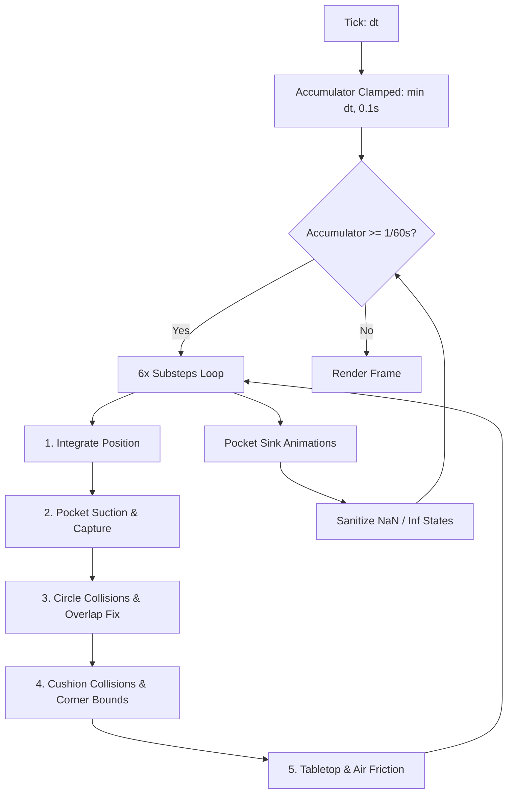
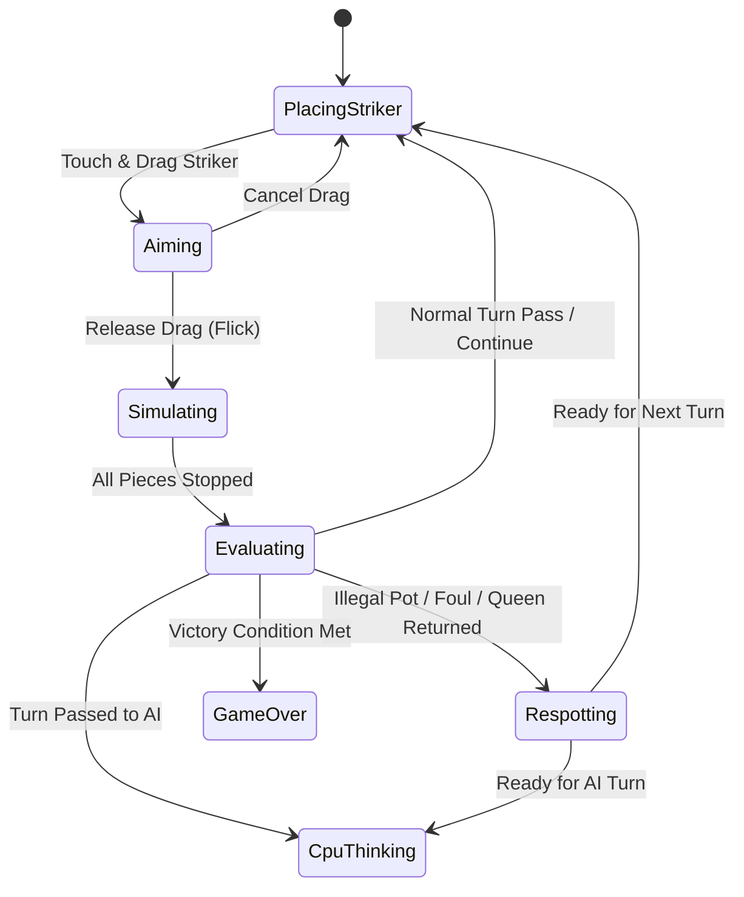
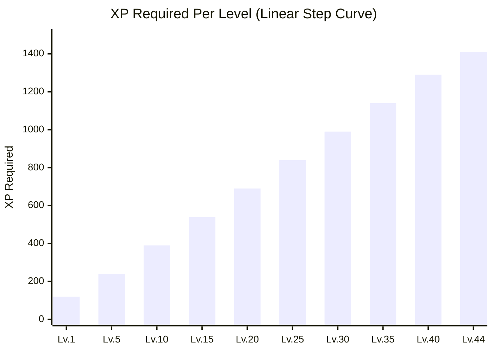

# Carrom Zone — Comprehensive Game Architecture, Mechanics & AI Specification

An exhaustive technical and gameplay reference for **Carrom Zone** (Flutter + Flame Canvas Engine). This document details every mathematical model, physics integration, rule evaluation logic, AI prediction pipeline, state machine transition, and progression mechanic present in the production codebase.

---

## 1. System Architecture & Coordinate Framework

### 1.1 The Virtual Coordinate System
Carrom Zone calculates all physics, trajectories, AI raycasts, and baseline constraints in a standardized **virtual coordinate plane** with origin $(0, 0)$ anchored at the geometric center of the board:
* **Board Dimensions:** $400.0 \times 400.0$ units.
* **Coordinate Extents:** $X \in [-200.0, +200.0]$, $Y \in [-200.0, +200.0]$.
* **Frame Thickness:** $35.0$ units around the outer perimeter.
* **Total Enclosure:** $(400 + 35 \times 2) = 470.0 \times 470.0$ units.
* **Canvas Projection:** Responsive viewport scaling factor:
  $$\text{scale} = \frac{\min(\text{width}, \text{height})}{\text{boardSize} + 2 \times \text{frameWidth}}$$
  All visual strokes, circles, and collision offsets are dynamically scaled, providing subpixel accuracy across high-DPI mobile devices and tablets.

### 1.2 Tabletop Constants & Radii
| Element | Radius / Value | Mass | Coordinate Offset | Notes |
|---|---|---|---|---|
| **Carrom Board** | $400 \times 400$ | $\infty$ | Half-board = $200.0$ | Inner playfield boundary = $184.0$ |
| **Carrom Piece (Carrom Men)** | $12.0$ | $1.0$ | Center = $(0, 0)$ | 9 White, 9 Black |
| **Queen (Red)** | $12.0$ | $1.0$ | Center = $(0, 0)$ | High-value centerpiece |
| **Striker (Ivory/Pearl)** | $16.0$ | $2.8$ | Baseline $Y = \pm 142.0$ | Heavy impact disk ($2.8\times$ piece mass) |
| **Pockets (4 Corners)** | $19.0$ | Hole | $(\pm 178.0, \pm 178.0)$ | Funnel capture suction zone |
| **Cushion Playfield** | $184.0$ | $\infty$ | Bound $Y = \pm 184.0$ | Wood frame cushion with restitution |

---

## 2. Tabletop Physics Engine (`CarromPhysics`)

The simulation runs through a deterministic, frame-rate-independent physics solver with multi-tier sub-stepping, speculative contact clamping, and continuous collision detection (CCD).

### 2.1 Fixed Timestep & Sub-Stepping
* **Base Timestep:** $\Delta t_{\text{fixed}} = \frac{1}{60}\text{ s} \approx 0.01667\text{ s}$.
* **Time Accumulator Cap:** $0.1\text{ s}$ maximum accumulator window. Prevents the "spiral of death" (frame drops triggering infinite catch-up loops during app backgrounding).
* **Discrete Sub-steps:** $N = 6$ sub-steps per frame:
  $$\Delta t_{\text{sub}} = \frac{\Delta t_{\text{fixed}}}{6} = \frac{1}{360}\text{ s} \approx 0.002778\text{ s}$$
* **Sub-step Execution Cycle:**
  1. $\text{\_integratePositions}(\Delta t_{\text{sub}})$
  2. $\text{\_checkPocketCapture}(\Delta t_{\text{sub}})$
  3. $\text{\_resolveCircleCollisions}()$
  4. $\text{\_resolveWallCollisions}()$
  5. $\text{\_applyFriction}(\Delta t_{\text{sub}})$

### 2.2 Numerical Position Integration
Positions update linearly per sub-step scaled by normalized 60 Hz frame units:
$$\mathbf{p}_{t + \Delta t} = \mathbf{p}_t + \mathbf{v}_t \cdot (\Delta t_{\text{sub}} \times 60.0)$$

### 2.3 Friction & Damping Dynamics
Friction combines exponential tabletop contact drag with secondary aerodynamic drag:
$$\text{damping} = (1.0 - \mu_{\text{surface}})^{\Delta t_{\text{sub}} \times 60.0}, \quad \mu_{\text{surface}} = 0.026$$
$$\text{airDamping} = (1.0 - \mu_{\text{air}})^{\Delta t_{\text{sub}} \times 60.0}, \quad \mu_{\text{air}} = 0.013$$
$$\mathbf{v}_{t + 1} = \mathbf{v}_t \times (\text{damping} \times \text{airDamping})$$
* **Velocity Sleep Threshold:** When $\|\mathbf{v}\|^2 < (0.08)^2 = 0.0064$, the piece instantly sleeps: $\mathbf{v} = \mathbf{0}$.

### 2.4 Elastic Circle-to-Circle Collision Solver
When distance $d = \|\mathbf{p}_b - \mathbf{p}_a\| < r_a + r_b$:
1. **Collision Normal:**
   $$\mathbf{n} = \frac{\mathbf{p}_b - \mathbf{p}_a}{d} \quad (\text{falls back to } [1, 0]^T \text{ if } d < 10^{-4})$$
2. **Relative Velocity:**
   $$\mathbf{v}_{\text{rel}} = \mathbf{v}_b - \mathbf{v}_a$$
3. **Normal Impulse Calculation:**
   $$v_n = \mathbf{v}_{\text{rel}} \cdot \mathbf{n}$$
   If $v_n < 0$ (approaching):
   $$J = \frac{-(1 + e) \cdot v_n}{\frac{1}{m_a} + \frac{1}{m_b}}, \quad e = 0.86\text{ (Restitution)}$$
   $$\mathbf{v}_a' = \mathbf{v}_a - \frac{J \cdot \mathbf{n}}{m_a}, \quad \mathbf{v}_b' = \mathbf{v}_b + \frac{J \cdot \mathbf{n}}{m_b}$$
4. **Baumgarte Positional Penetration Correction:**
   To resolve overlap without energetic popping:
   $$\text{overlap} = (r_a + r_b) - d$$
   $$\mathbf{c} = \mathbf{n} \cdot \left(\frac{\text{overlap} \times 0.8}{m_a + m_b}\right)$$
   $$\mathbf{p}_a' = \mathbf{p}_a - \mathbf{c} \cdot m_b, \quad \mathbf{p}_b' = \mathbf{p}_b + \mathbf{c} \cdot m_a$$

### 2.5 Cushion & Corner Pocket Frame Collisions
* **Playing Boundary:** $X, Y \in [-184.0, +184.0]$.
* **Elastic Wall Rebound:** Normal velocity reversed with coefficient $e = 0.86$; tangential velocity retains $0.95$ surface scrub.
* **Corner Pocket Cutout:** Near corners ($|x| > 157.0$ and $|y| > 157.0$), the cushion boundary allows pieces to roll into the pocket.
* **Hard Outer Clamping:** Pieces are bounded at $\pm 196.0$, making tunneling through the corner joint physically impossible.

### 2.6 Pocket Capture & Funnel Suction
* **Pocket Center:** $\mathbf{p}_{\text{pocket}} = (\pm 178.0, \pm 178.0)$.
* **Suction Threshold:** $r_{\text{threshold}} = r_{\text{pocket}} + 14.0 = 33.0\text{ units}$.
* **Suction Gravity Funnel:** Inside this radius, smooth progressive acceleration pulls the piece inward:
  $$\mathbf{v} = \mathbf{v} \times (0.88)^{\Delta t_{\text{ratio}}} + \mathbf{u}_{\text{dir}} \cdot (1.5 \times \Delta t_{\text{ratio}})$$
* **Pocket Drop Threshold:** $r_{\text{drop}} = r_{\text{pocket}} + 2.0 = 21.0\text{ units}$. When entered, `isPocketed = true`, velocity is zeroed, and shrinking sink animation initiates.
* **Sink Animation:** Radius shrinks from $1.0 \rightarrow 0.0$ at rate $4.0\text{ s}^{-1}$ while position smoothly interpolates to the pocket center.

---

## 3. Carrom Rule Engine (`CarromTurnEvaluator`)

The game strictly adheres to **International Carrom Federation (ICF)** rules adapted for fast mobile play.

### 3.1 Initial Board Layout
19 pieces arranged in concentric rings (Mandala pattern):
* **Center $(0, 0)$:** 1 Red Queen ($r = 12.0$).
* **Inner Ring (6 pieces, $R = 26.0$):** Alternating 3 White, 3 Black at $60^\circ$ steps starting at $-90^\circ$.
* **Outer Ring (12 pieces, $R = 52.0$):** Alternating 6 White, 6 Black at $30^\circ$ steps.

### 3.2 Turn Evaluation Matrix
At the conclusion of physics simulation, all pocketed pieces are evaluated:

| Condition | Points Awarded | Queen State | Turn Outcome | Respot Action |
|---|---|---|---|---|
| **Pockets $\ge 1$ Own Piece cleanly** | $+1$ per piece | Unchanged | **Continues Turn** | None |
| **Striker Potted (Foul)** | $-1$ penalty (floor 0) | If potted this turn: Reset to center | **Turn Passes** | Potted own pieces returned + 1 penalty piece returned |
| **Queen Potted alone** | $0$ (Pending) | `needsCover = true` | **Continues Turn** | Queen held in escrow |
| **Queen Potted + Own Piece in same shot** | $+3$ (Queen) $+1$ (Coin) | `queenCovered = true` | **Continues Turn** | None (Immediate cover) |
| **Cover Shot: Pockets Own Piece** | $+3$ (Queen) $+1$ (Coin) | `queenCovered = true` | **Continues Turn** | Queen awarded to current player |
| **Cover Shot: Misses all own pieces** | $0$ | Reset (`queenCovered = false`) | **Turn Passes** | **Queen returned to center** |
| **Pockets Opponent Piece (Clean)** | Credited to Opponent | Unchanged | **Turn Passes** | Opponent coin remains pocketed |
| **Pockets Own + Opponent Piece** | Both scored to owners | Unchanged | **Turn Passes** | Turn passes to opponent |
| **Premature Last Piece** (Pots 9th piece before Queen covered) | $+0$ | Unchanged | **Turn Passes** | **Last piece respotted to center** |

### 3.3 Deterministic Center Respotting (`CarromRespotter`)
When a Queen, foul piece, or penalty piece must be returned to the board:
1. Clearance distance required: $\Delta d = r_a + r_b = 24.0\text{ units}$.
2. **Step 1:** Attempt exact center $(0, 0)$.
3. **Step 2 (Concentric Search):** Check radiating concentric circles ($R \in [25.0, 50.0, 75.0]$) across 8 deterministic angular rays:
   $$\theta \in \left[-\frac{\pi}{2}\text{ (Top)}, +\frac{\pi}{2}\text{ (Bottom)}, 0\text{ (Right)}, \pi\text{ (Left)}, \pm\frac{\pi}{4}, \pm\frac{3\pi}{4}\right]$$
4. The first non-overlapping spot is selected, guaranteeing zero piece overlaps and deterministic reproduction across devices.

### 3.4 Match Win & Scoring
A player wins when:
1. All 9 of their pieces are pocketed **AND** the Queen is pocketed and covered.
2. **Final Match Score:**
   $$\text{Winner Score} = \text{Remaining Opponent Pieces on Board} + (\text{Queen Covered by Winner ? } 3 : 0)$$

---

## 4. Artificial Intelligence Engine (`CarromAI`)

The AI engine uses **deterministic forward-lookahead simulation** and geometric ray-casting rather than random heuristics.

### 4.1 Decision Pipeline Stages
1. **Target Prioritization:**
   * If `needsQueenCover`: Targets only own pieces with highest pot viability.
   * If Queen is available and $\le 1$ own piece left: Prioritizes Queen exclusively to avoid premature last piece foul.
   * If Queen is available and $\le 4$ own pieces left: Queen placed at top of priority list.
2. **Baseline Sliding Solver:**
   Generates legal striker coordinates $X \in [-85.0, +85.0]$ in increments of $8.0\text{ units}$. Filters out positions where distance to any on-board piece is $< (16.0 + 12.0) = 28.0$.
3. **Direct Geometric Pocket Cut Calculation:**
   For each striker candidate, target piece, and corner pocket:
   * **Ghost Ball Position:** Point $\mathbf{p}_{\text{ghost}}$ where striker must impact target:
     $$\mathbf{p}_{\text{ghost}} = \mathbf{p}_{\text{target}} - \mathbf{u}_{\text{toPocket}} \times (r_{\text{striker}} + r_{\text{target}})$$
   * **Cut Angle:**
     $$\theta_{\text{cut}} = \arccos(\mathbf{u}_{\text{strikerToGhost}} \cdot \mathbf{u}_{\text{toPocket}})$$
     Shots with cut angles $> 80^\circ$ are discarded as geometrically unfeasible.
4. **Cushion Bank Shot Solver:**
   Calculates single-rail bank shots by creating a virtual mirror pocket behind the left and right cushions:
   $$\mathbf{p}_{\text{mirror}} = (2 \times X_{\text{cushion}} - X_{\text{pocket}}, Y_{\text{pocket}})$$
   Solves the reflection line to find exact rail bounce contact.

### 4.2 Isolated Sandbox Physics Forward-Simulation
The top candidate shots are tested inside a headless sandbox clone of `CarromPhysics`:
* **Zero Live Mutation:** Live pieces and live state are never touched.
* **Lookahead Budget:** Up to 35 ticks ($\approx 0.58\text{ s}$) per candidate.
* **Simulation Scoring Function:**
  $$S = S_{\text{pot}} + S_{\text{queen}} + S_{\text{bank}} + S_{\text{efficiency}} - S_{\text{foul}} - S_{\text{oppPot}} - S_{\text{power}}$$
  * Target potted: $+350.0$
  * Queen potted: $+150.0$ ($+500.0$ total)
  * Verified cushion bank pot: $+50.0$
  * Same-shot Queen cover: $+200.0$
  * Scratch / Striker potted: $-600.0$ (Immediate disqualification)
  * Opponent coin potted alone: $-250.0$
  * Proximity improvement (if missed): $+(\Delta d_{\text{progress}} \times 0.35)$

### 4.3 Difficulty Calibration Profiles
| Attribute | Easy | Medium | Hard |
|---|---|---|---|
| **Forward Simulation Candidates** | 2 | 4 | 6 |
| **Cushion Bank Shots** | Disabled | Fallback only | Enabled (All cushions) |
| **Angle Jitter (Gaussian)** | $\pm 4.5^\circ$ ($\sigma \approx 0.08\text{ rad}$) | $\pm 2.2^\circ$ ($\sigma \approx 0.04\text{ rad}$) | $\pm 0.8^\circ$ ($\sigma \approx 0.015\text{ rad}$) |
| **Power Variance** | $\pm 10\%$ | $\pm 5\%$ | $\pm 2\%$ |
| **Tactical Safety Play** | Random push | Basic defense | Strategic corner hiding |

---

## 5. Game State Machine (`GameStateMachine`)

Turn lifecycle, gesture handling, animations, and transitions are managed through a unified state machine:

| Operational State | Permitted Next States | Description |
|---|---|---|
| `placingStriker` | `aiming`, `cpuThinking`, `paused`, `gameOver` | Striker placed on baseline; horizontal slider active. |
| `aiming` | `simulating`, `placingStriker`, `paused` | User dragging touch vector; aim line & power gauge active. |
| `simulating` | `evaluating`, `paused` | Physics running at 60 Hz; all user input locked. |
| `evaluating` | `respotting`, `placingStriker`, `cpuThinking`, `gameOver`, `paused` | Physics stopped; evaluating potted coins, fouls, and queen. |
| `respotting` | `placingStriker`, `cpuThinking`, `gameOver`, `paused` | Penalty/Queen return animation running. |
| `cpuThinking` | `simulating`, `paused`, `placingStriker`, `gameOver` | AI calculating and animating striker slide/flick. |
| `paused` | Any active state | Gameplay suspended; physics accumulator frozen. |
| `gameOver` | `placingStriker` | Match ended; victory dialog presented. |

---

## 6. Player Progression & Theme Unlock Engine

### 6.1 XP Progression Formula
Player XP accumulates across matches without resetting on level up:
* **Match Win:** $+100\text{ XP}$
* **Match Draw:** $+50\text{ XP}$
* **Match Loss:** $+20\text{ XP}$
* **Practice / Abandoned / Invalid Match:** $0\text{ XP}$
* **Exploit Protection:** Match IDs are persisted in `StorageService`; duplicate reward grants for identical match sessions are rejected with an asynchronous in-flight lock.

The XP required to progress from level $L$ to $L + 1$ follows a balanced, linear progression curve:
$$\text{XP}_{\text{req}}(L) = 120 + 30(L - 1) = 90 + 30L \quad (\text{for } 1 \le L < 45)$$
$$\text{XP}_{\text{cumulative}}(L) = 120(L - 1) + 15(L - 1)(L - 2) \quad (\text{Level 45 Cap: } 33,660\text{ XP})$$

The closed-form analytical inverse solves for player level $L$ from cumulative XP $T$:
$$15n^2 + 105n - T = 0 \implies n = \left\lfloor \frac{-105 + \sqrt{11025 + 60T}}{30} \right\rfloor, \quad L = \min(45, n + 1)$$

### 6.2 Table Theme Unlock Catalog
All 11 board themes feature unique hardwood frame palettes, baize fabrics, corner plate finishes, and custom baseline styles:

| Theme Name | Theme ID | Unlock Level | Surface Type | Frame Finish |
|---|---|---|---|---|
| **Classic Birch & Rosewood** | `mahogany` | **Level 1** | Warm Birchwood | Hand-rubbed Rosewood |
| **Heritage Club Teal** | `emerald` | **Level 1** | Tournament Teal Baize | Walnut & Brushed Brass |
| **Royal Navy Lounge** | `midnight` | **Level 1** | Architectural Navy Slate | Espresso Ebony & Gold Inlay |
| **Walnut Club** | `walnutClub` | **Level 3** | Dark American Walnut | Polished Brass Brackets |
| **Royal Indigo** | `royalIndigo` | **Level 6** | Velvet Sapphire Indigo | Platinum Silver Trim |
| **Emerald Lounge** | `emeraldLounge` | **Level 10** | Forest Emerald Felt | Antique Gold Filigree |
| **Ocean Breeze** | `oceanBreeze` | **Level 15** | Aquamarine Lagoon | Bleached Driftwood |
| **Sakura Studio** | `sakuraStudio` | **Level 21** | Cherry Blossom Ivory | Warm Rosewood & Rose Gold |
| **Neon Arena** | `neonArena` | **Level 28** | Cyber Matte Carbon | Laser Vector Trim |
| **Golden Palace** | `goldenPalace` | **Level 36** | Champagne Silk Baize | 24k Polished Gold Trim |
| **Cosmic Elite** | `cosmicElite` | **Level 45** | Nebula Stardust Slate | Etched Constellation Inlay |

---

## 7. Rendering & Design System Architecture

### 7.1 Single Source of Truth Theme Visuals
* **Procedural Master (`BoardPainter`):** Renders all 11 themes directly on Skia canvas (shadows, bevels, wood textures, baseline circles, corner arrows, center mandala rosette, and corner brass plates).
* **`ThemeBoardPreview` Widget:** A unified component that renders the identical in-game board, starting 19-piece flower pattern, and striker across `ThemeCollectionScreen`, `SettingsScreen`, `DevThemeTester`, and `GameOverDialog`.
* **Automated Asset Generation (`render_theme_thumbnails_test.dart`):** Executes on `flutter test` to capture 512×512 exact Skia renders directly from `BoardPainter` + `PiecePainter` into `assets/images/themes/{theme}.png` and `.webp`, eliminating visual drift between UI thumbnails and gameplay.

---

## 8. Verification & Test Suite
The implementation is validated by a 51-test suite across 6 test modules:
* `ai_prediction_test.dart`: Live state isolation, deterministic trajectory verification, foul avoidance, Queen cover logic, decision latency ($< 10\text{ ms}$).
* `physics_reliability_test.dart`: Multi-FPS determinism (30, 60, 120 FPS), tunneling prevention at maximum impulse ($22.0$).
* `rules_reliability_test.dart`: Queen cover logic, striker fouls, penalty piece returns, score non-negativity, deterministic non-overlapping respotting.
* `state_management_reliability_test.dart`: State transition gates, rapid pause/resume stability, illegal input rejection.
* `render_theme_thumbnails_test.dart`: Headless canvas thumbnail snapshot generation for all 11 themes.
* `widget_test.dart`: Smoke test loading application shell.

