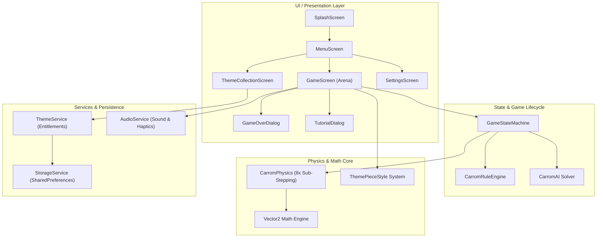
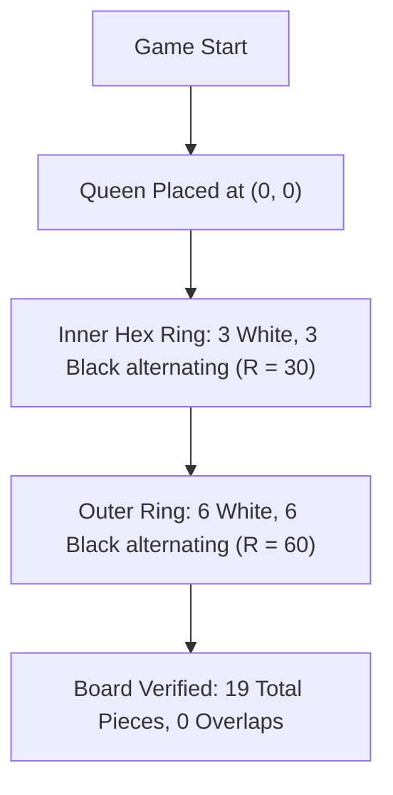
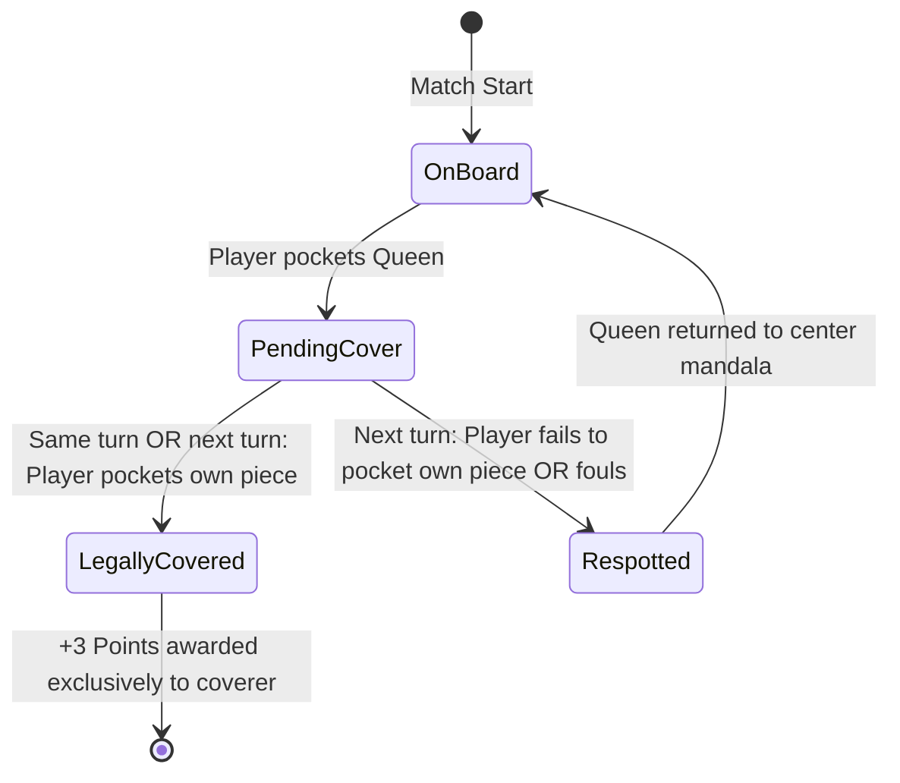
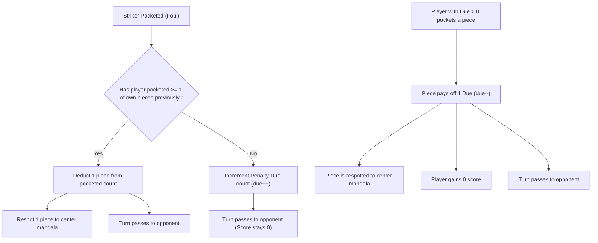
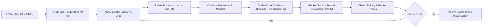
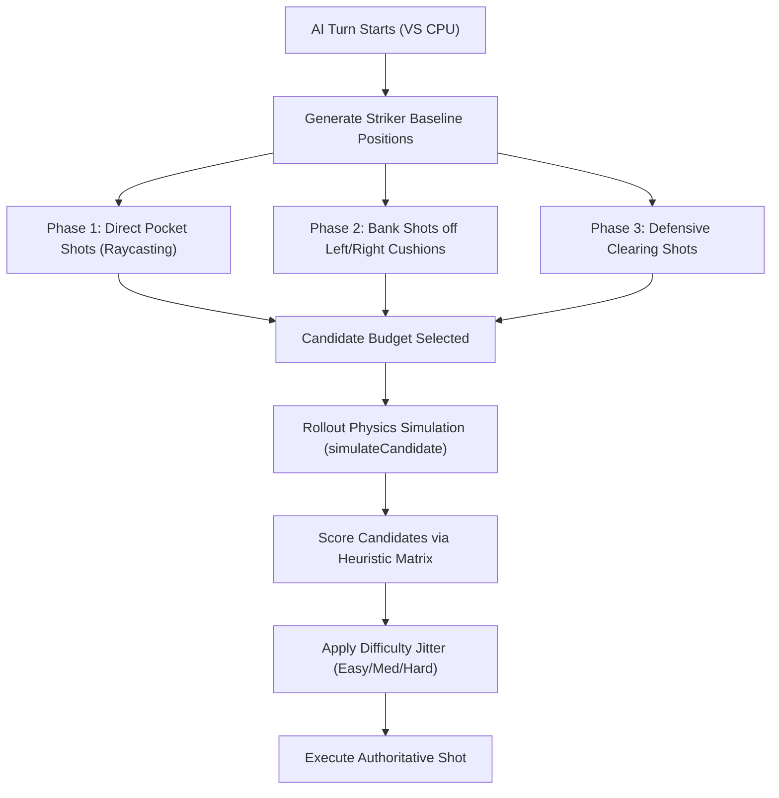
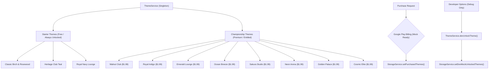
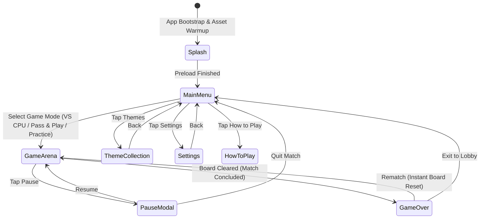
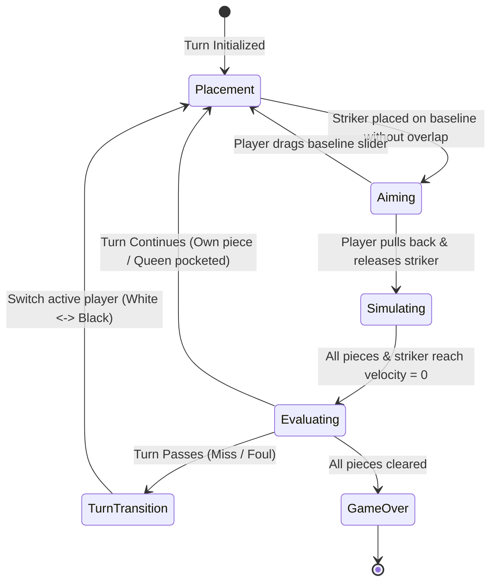
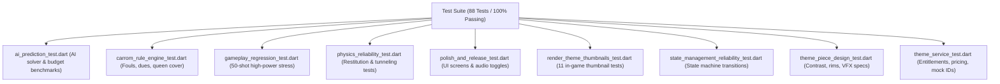

# 🎯 CARROM ZONE — MASTER GAME LOGIC, MECHANICS & ARCHITECTURE SPECIFICATION

> **Document Version:** 2.0.0 (Production Release Specification)  
> **Game Title:** Carrom Zone (Modern Carrom Club Edition)  
> **Framework:** Flutter 3.24+ / Dart 3.5+  
> **Platforms:** Android, iOS, Web (WASM / CanvasKit), macOS, Windows, Linux  
> **Engine:** Custom Deterministic 2D Sub-Stepped Impulse Physics Engine  
> **Rendering:** Hardware-Accelerated Flutter CustomPainter with Theme-Based Aesthetics  
> **Design Identity:** Modern Carrom Club (Warm Alabaster, Sandalwood, Antique Brass & Ebony)

---

## 📑 TABLE OF CONTENTS

1. [Executive Summary & System Architecture](#1-executive-summary--system-architecture)
2. [Project Directory & File Responsibility Map](#2-project-directory--file-responsibility-map)
3. [Virtual Coordinate System & Table Dimensions](#3-virtual-coordinate-system--table-dimensions)
4. [Official Carrom Rule Engine & Game Mechanics](#4-official-carrom-rule-engine--game-mechanics)
   - 4.1 Piece Inventory & Initial Board Layout
   - 4.2 Striker Placement & Baseline Invariants
   - 4.3 Queen Cover Mechanics & Exclusivity
   - 4.4 Foul Logic & Penalty Due System
   - 4.5 Turn Continuation & Turn Passing
   - 4.6 Authoritative Scoring & Match Clearance
   - 4.7 Deterministic Spiral Respotting Algorithm
5. [Custom Sub-Stepped 2D Physics Engine](#5-custom-sub-stepped-2d-physics-engine)
   - 5.1 Sub-Stepping & Numerical Integration (8x)
   - 5.2 Linear Kinetic Friction & Drag
   - 5.3 Impulse-Based Disk Collision Resolution
   - 5.4 Baumgarte Positional Stabilization (Anti-Overlap & Anti-Tunneling)
   - 5.5 Cushion Rebound & Boundary Dynamics
   - 5.6 Corner Pocket Suction Gravity Funnel
6. [Intelligent Multi-Tier AI Decision Engine](#6-intelligent-multi-tier-ai-decision-engine)
   - 6.1 Geometric Direct-Shot Raycasting
   - 6.2 Bank Shot Cushion Reflection Solver
   - 6.3 Defensive & Positional Play Solver
   - 6.4 Fast Rollout Physics Simulation
   - 6.5 Difficulty Scaling Matrix (Easy, Medium, Hard)
7. [Theme-Based Visuals & Piece Design System](#7-theme-based-visuals--piece-design-system)
   - 7.1 Visual Identity Across All 11 Themes
   - 7.2 High-Contrast Piece Rendering Invariants
   - 7.3 Theme-Specific Striker Designs & VFX Trails
   - 7.4 Particle System & Impact Sparks
8. [Premium Theme Catalog & Monetization Architecture](#8-premium-theme-catalog--monetization-architecture)
   - 8.1 Starter Free Themes vs Championship Premium Themes
   - 8.2 Entitlement Management & Safe Fallback
   - 8.3 Google Play Billing Mock Architecture
   - 8.4 Developer Testing Options & Mock Overrides
9. [Application Lifecycle, State Machines & Screen Flows](#9-application-lifecycle-state-machines--screen-flows)
   - 9.1 Global Navigation State Flow
   - 9.2 Turn State Machine
   - 9.3 Screen-by-Screen Component Specifications
10. [Audio Engineering & Contextual Haptics](#10-audio-engineering--contextual-haptics)
11. [Data Persistence & Storage Layer](#11-data-persistence--storage-layer)
12. [Verification Suite & Quality Assurance Benchmarks](#12-verification-suite--quality-assurance-benchmarks)

---

## 1. EXECUTIVE SUMMARY & SYSTEM ARCHITECTURE

**Carrom Zone** is a casino-grade, tournament-accurate digital recreation of the traditional tabletop board game of Carrom. Built strictly in native Dart/Flutter, the engine eschews third-party physics libraries (such as Box2D or Chipmunk) in favor of a specialized **deterministic 2D impulse-based physics pipeline** optimized for zero-tunneling circular disk dynamics, cushion coefficient of restitution, and corner pocket suction wells.



### Key Architectural Pillars
- **Zero Drift Determinism:** Discrete physics simulation with strict $dt = 1/60$s divided into 8 sub-steps ($dt / 8 \approx 2.08\text{ms}$) guarantees that shot replays and AI candidate evaluations remain identical across hardware platforms.
- **Rule Engine Authoritativeness:** Turn evaluation, Queen cover statuses, fouls, dues, and final scores are evaluated through a single immutable snapshot pipeline (`TurnResult`), preventing race conditions and UI de-synchronization.
- **Visual Separation Invariant:** Board aesthetics never affect physical attributes (radius, mass, hitbox, coordinates, or friction coefficients).

---

## 2. PROJECT DIRECTORY & FILE RESPONSIBILITY MAP

```
lib/
├── main.dart                       # Application entry point, orientation lock, services bootstrap
├── ai/
│   └── carrom_ai.dart              # Multi-tier AI solver, raycasting, bank shot solver, rollout simulation
├── core/
│   ├── app_colors.dart             # Central color design tokens & 11 theme definitions
│   ├── carrom_rule_engine.dart     # Authoritative ICF carrom rules, fouls, queen cover, dues, respotting
│   ├── design_system.dart          # Modern Carrom Club reusable UI components, badges, icons, cards
│   ├── dev_options.dart            # Developer testing console, mock unlock overrides, debug toggles
│   ├── game_config.dart            # Authoritative game constants, dimensions, masses, coordinates
│   ├── game_state_machine.dart     # Turn lifecycle state machine & transition guards
│   ├── theme_piece_style.dart      # Theme-based piece styling (colors, gradients, rims, striker VFX)
│   └── vector2.dart                # High-performance 2D vector mathematics library
├── models/
│   ├── game_mode.dart              # GameMode, PlayerColor, AiDifficulty enums
│   ├── game_state.dart             # Snapshot models of active pieces, scores, dues, and turn states
│   ├── piece_model.dart            # Piece entity model (type, pos, vel, mass, radius, pocket status)
│   └── turn_result.dart            # Immutable turn evaluation outcome model
├── painters/
│   ├── aim_painter.dart            # Drag gesture trajectory, aim dashed lines, ghost preview
│   ├── board_painter.dart          # Hardware-accelerated canvas rendering of carrom board & frame
│   ├── particle_painter.dart       # VFX particles (pocket confetti, striker sparks, impact shockwaves)
│   └── piece_painter.dart          # Themed piece rendering (multi-stop radial gradients, specular highlights)
├── physics/
│   └── carrom_physics.dart         # Sub-stepped impulse physics, collision detection, pocket funnels
├── screens/
│   ├── game_over_dialog.dart       # Authoritative match score dialog, winner banner, rematch button
│   ├── game_screen.dart            # Primary gameplay arena, input gesture recognizers, HUD
│   ├── menu_screen.dart            # Main lobby, game mode selection cards, active theme pill
│   ├── settings_screen.dart        # Audio toggles, AI difficulty picker, rules modal, data reset
│   ├── splash_screen.dart          # Animated startup screen, asset preload
│   ├── theme_collection_screen.dart# Starter (Free) vs Championship (Premium) catalog & store
│   └── tutorial_dialog.dart        # Illustrated rules and shot controls guide
└── services/
    ├── audio_service.dart          # Sound pool management, low-latency playback, contextual haptics
    ├── storage_service.dart        # SharedPreferences persistence layer (themes, options, audio)
    └── theme_service.dart          # Theme catalog, entitlement verification, mock billing integration
```

---

## 3. VIRTUAL COORDINATE SYSTEM & TABLE DIMENSIONS

The game simulation operates on a fixed, resolution-independent virtual Cartesian plane centered at $(0, 0)$.

```
(-370, -370) ┌─────────────────────── [Y = -370] ───────────────────────┐ (370, -370)
             │                     WOODEN FRAME                        │
             │   (-295, -295)                               (295, -295)│
             │      ● [Pocket TL]               [Pocket TR] ●          │
             │        ┌───────────────────────────────────┐            │
             │        │    ○ ═══════════════════════ ○    │            │
             │        │    [Y = -230] Black Baseline      │            │
             │        │                                   │            │
             │        │                (0,0)              │            │
 [X = -370]  │        │               ╔═════╗             │            │  [X = 370]
             │        │               ║ (Q) ║ [Mandala]   │            │
             │        │               ╚═════╝             │            │
             │        │                                   │            │
             │        │    ○ ═══════════════════════ ○    │            │
             │        │    [Y = 230] White Baseline       │            │
             │        └───────────────────────────────────┘            │
             │      ● [Pocket BL]               [Pocket BR] ●          │
             │   (-295, 295)                                 (295, 295)│
             │                     WOODEN FRAME                        │
(-370, 370)  └─────────────────────── [Y = 370] ───────────────────────┘ (370, 370)
```

### Numerical Dimensional Specifications (`GameConfig`)

| Dimension Property | Virtual Units | Description / Purpose |
|:---|:---|:---|
| **Board Full Size** | $740.0 \times 740.0$ | Total outer canvas dimension including bevels |
| **Wooden Frame Width** | $50.0$ | Hardwood perimeter border with corner plates |
| **Play Area Size** | $640.0 \times 640.0$ | Active playable baize surface ($[-320, 320]$) |
| **Pocket Radius** | $22.5$ | Physical capture aperture at each of the 4 corners |
| **Pocket Center Coordinates** | $(\pm 295.0, \pm 295.0)$ | Top-Left, Top-Right, Bottom-Left, Bottom-Right |
| **Pocket Suction Radius** | $55.0$ | Radius where gravitational suction well activates |
| **Piece Radius ($r_p$)** | $15.0$ | Radius of White, Black, and Queen pieces |
| **Striker Radius ($r_s$)** | $20.0$ | Radius of player and CPU strikers |
| **Piece Mass ($m_p$)** | $10.0$ | Mass unit for linear momentum conservation |
| **Striker Mass ($m_s$)** | $30.0$ | $3.0\times$ piece mass for realistic kinetic transfer |
| **White Baseline Y** | $+230.0$ | Center line for White player striker placement |
| **Black Baseline Y** | $-230.0$ | Center line for Black player / CPU striker placement |
| **Baseline Half-Width** | $180.0$ | Extent along X axis (usable range $[-180.0, 180.0]$) |
| **Baseline Circle Radius** | $15.0$ | Baseline endpoint red circles ($X = \pm 180.0$) |
| **Center Mandala Radius** | $40.0$ / $80.0$ | Inner Queen circle ($40$) and outer boundary ($80$) |

---

## 4. OFFICIAL CARROM RULE ENGINE & GAME MECHANICS

The rule engine (`CarromRuleEngine`) enforces standard International Carrom Federation (ICF) rules with complete state determinism.

### 4.1 Piece Inventory & Initial Board Layout
- **Total Pieces:** 19 pieces on board at match start.
  - **9 White Pieces** (Assigned to Player 1 / Human in VS CPU).
  - **9 Black Pieces** (Assigned to Player 2 / AI in VS CPU).
  - **1 Queen Piece** (Crimson / Ruby red, placed precisely at $(0, 0)$).
- **Arrangement Geometry:**
  - Center: Queen at $(0, 0)$.
  - **Inner Ring (6 pieces):** Radius $30.0$ from origin at angles $k \cdot \frac{\pi}{3}$, alternating White and Black pieces.
  - **Outer Ring (12 pieces):** Radius $60.0$ from origin at angles $k \cdot \frac{\pi}{6}$, alternating White and Black pieces.



---

### 4.2 Striker Placement & Baseline Invariants
Before a shot can be executed:
1. **Vertical Constraint:** The striker center must lie strictly on the active player's baseline ($Y = +230.0$ for White, $Y = -230.0$ for Black).
2. **Horizontal Bounds:** The striker center $X$ must be clamped to $[-180.0, 180.0]$.
3. **No-Overlap Invariant:** The striker cannot be released if it overlaps any active piece on the board:
   $$\text{overlap} = \text{distance}(\vec{P}_{\text{striker}}, \vec{P}_{\text{piece}}) < (r_s + r_p)$$
   If an overlap is detected, the UI indicates an invalid position and prevents shooting.
4. **Baseline Circle Touching Rule:** A striker placed on the baseline circle must either completely cover the circle or not touch it at all.

---

### 4.3 Queen Cover Mechanics & Exclusivity
The Queen is the highest-value coin on the board (+3 points). However, pocketing the Queen alone does **not** grant the points:



#### Detailed Queen Cover Rules:
1. **Pending Cover State:** When Player $A$ pockets the Queen, `queenCoveredBy` is set to Player $A$, and `needsQueenCover` becomes `true`.
2. **Simultaneous Cover:** If Player $A$ pockets the Queen AND one of their own pieces in the **same shot**, the Queen is covered immediately.
3. **Subsequent Cover:** If Player $A$ pockets only the Queen, their turn continues. In their immediate next shot, they must pocket at least one of their own pieces.
   - If successful: The Queen is covered. Player $A$ gains +3 points at the end of the match.
   - If unsuccessful (missed pot, pocketed opponent piece only, or pocketed striker): The Queen is uncovered and **immediately respotted** to the center mandala.
4. **Exclusivity:** Queen bonus (+3 points) can **never** be awarded twice, and can **never** be awarded to a player who did not legally cover it.

---

### 4.4 Foul Logic & Penalty Due System
A foul occurs whenever a player pockets the striker (known as a **Scratch**):



#### Deadlock Safety Invariant:
If a player has pending penalty dues but there are **zero pieces remaining on the board**, the match logic automatically settles the due against the player's final score instead of waiting for a coin to respot, preventing frozen or hung matches.

---

### 4.5 Turn Continuation & Turn Passing
A player's turn is governed by `CarromRuleEngine.evaluateTurn()`:

| Scenario | Turn Outcome | Notes |
|:---|:---|:---|
| **Pocketed $\ge 1$ Own Piece(s) (No foul)** | **Continues Turn** | Player shoots again |
| **Pocketed Queen (No foul)** | **Continues Turn** | Player shoots to cover Queen |
| **Pocketed Own Piece + Queen (No foul)** | **Continues Turn** | Queen covered + turn continues |
| **Pocketed 0 Pieces** | **Passes Turn** | Normal miss |
| **Pocketed Opponent Piece Only** | **Passes Turn** | Opponent receives credit; turn passes |
| **Pocketed Striker (Foul)** | **Passes Turn** | Penalty piece respotted or due recorded |
| **Pocketed Striker + Own Piece** | **Passes Turn** | Striker foul overrides pot; piece respotted |

---

### 4.6 Authoritative Scoring & Match Clearance
A match concludes when all 9 pieces of either color are cleared from the board:

$$\text{Final Score} = \text{Pocketed Pieces} + \text{Queen Bonus (3 if covered)} - \text{Penalty Dues}$$

#### Match Winner Determination:
1. **Clearance Victory:** The player who cleared all 9 of their pieces wins the match.
2. **Authoritative Score Reconciliation:** If White has 9 pieces pocketed + Queen cover (3 points), White finishes with 12 points. If Black has 6 pieces pocketed, Black finishes with 6 points.
3. The scoreboard and the Game Over Dialog consume the **identical authoritative model** (`GameState` / `TurnResult`), ensuring zero score discrepancy between in-game HUD and post-game summary.

---

### 4.7 Deterministic Spiral Respotting Algorithm
When a Queen or penalty coin must be returned to the board, it must be placed within the center circle without overlapping existing pieces.

```dart
Vector2 findFreeCenterSpot(List<PieceModel> activePieces, double pieceRadius) {
  final Vector2 center = Vector2.zero();
  if (!_isSpotOccupied(center, activePieces, pieceRadius)) {
    return center;
  }

  // Archimedean spiral search: r = step * theta
  double radius = pieceRadius * 2.1;
  const double maxRadius = 120.0;
  const double angleStep = math.pi / 6.0; // 30-degree increments
  const double radiusStep = 4.0;

  while (radius <= maxRadius) {
    for (double angle = 0.0; angle < 2.0 * math.pi; angle += angleStep) {
      final Vector2 candidate = Vector2(
        center.x + radius * math.cos(angle),
        center.y + radius * math.sin(angle),
      );
      if (!_isSpotOccupied(candidate, activePieces, pieceRadius)) {
        return candidate;
      }
    }
    radius += radiusStep;
  }
  return center;
}
```

---

## 5. CUSTOM SUB-STEPPED 2D PHYSICS ENGINE

The physics engine (`CarromPhysics`) runs a deterministic Euler numerical integrator with 8 sub-steps per frame.



### 5.1 Sub-Stepping & Numerical Integration (8x)
Standard $60\text{Hz}$ physics simulation ($dt \approx 16.67\text{ms}$) suffers from **bullet tunneling** at high striker velocities ($v > 1200\text{ units/s}$). 
By subdividing each frame into $N = 8$ sub-steps:
$$\Delta t_{\text{sub}} = \frac{\Delta t}{8} \approx 2.083\text{ ms}$$
The maximum displacement of any disk per sub-step is capped well below piece radii, entirely eliminating mesh tunneling without heavy continuous collision detection (CCD) tree overhead.

---

### 5.2 Linear Kinetic Friction & Drag
Friction on the baize cloth consists of linear velocity decay and quadratic air resistance:
$$\vec{v}_{t + \Delta t} = \vec{v}_t \cdot \max\left(0, 1 - \mu_{\text{surface}} \cdot \Delta t\right)$$
Where:
- $\mu_{\text{piece}} = 0.988$ per sub-step.
- $\mu_{\text{striker}} = 0.985$ per sub-step.
- **Sleep Threshold:** If $|\vec{v}| < 1.5\text{ units/s}$, velocity is clamped to $\vec{0}$ to prevent infinite floating-point creeping.

---

### 5.3 Impulse-Based Disk Collision Resolution
When two circular pieces $A$ and $B$ collide:
1. **Contact Normal:**
   $$\hat{n} = \frac{\vec{P}_B - \vec{P}_A}{|\vec{P}_B - \vec{P}_A|}$$
2. **Relative Velocity:**
   $$\vec{v}_{\text{rel}} = \vec{v}_A - \vec{v}_B$$
3. **Closing Velocity along Normal:**
   $$v_n = \vec{v}_{\text{rel}} \cdot \hat{n}$$
   *(If $v_n \le 0$, the pieces are already separating; collision is skipped).*
4. **Impulse Scalar ($J$):**
   $$J = \frac{-(1 + e) \cdot v_n}{\frac{1}{m_A} + \frac{1}{m_B}}$$
   Where coefficient of restitution $e = 0.92$.
5. **Velocity Updates:**
   $$\vec{v}_A \leftarrow \vec{v}_A + \frac{J}{m_A} \cdot \hat{n}$$
   $$\vec{v}_B \leftarrow \vec{v}_B - \frac{J}{m_B} \cdot \hat{n}$$

---

### 5.4 Baumgarte Positional Stabilization (Anti-Overlap)
Due to discrete time stepping, pieces may overlap by $\delta = (r_A + r_B) - |\vec{P}_B - \vec{P}_A| > 0$.
To eliminate sinking and jitter, a Baumgarte positional correction vector is applied:
$$\vec{P}_A \leftarrow \vec{P}_A - \hat{n} \cdot \left(\frac{\delta}{2} \cdot 0.8\right)$$
$$\vec{P}_B \leftarrow \vec{P}_B + \hat{n} \cdot \left(\frac{\delta}{2} \cdot 0.8\right)$$

---

### 5.5 Cushion Rebound & Boundary Dynamics
The playable baize boundary is bounded by $[-320.0 + r, 320.0 - r]$:
- Horizontal Cushion Collision ($|X| \ge 320.0 - r$):
  $$v_x \leftarrow -v_x \cdot e_{\text{cushion}}$$
  $$v_y \leftarrow v_y \cdot \mu_{\text{tangential}}$$
- Vertical Cushion Collision ($|Y| \ge 320.0 - r$):
  $$v_y \leftarrow -v_y \cdot e_{\text{cushion}}$$
  $$v_x \leftarrow v_x \cdot \mu_{\text{tangential}}$$
Where $e_{\text{cushion}} = 0.85$ and $\mu_{\text{tangential}} = 0.98$.

---

### 5.6 Corner Pocket Suction Gravity Funnel
Each of the 4 corner pockets acts as a physical gravity well:
1. If distance $d = |\vec{P}_{\text{piece}} - \vec{P}_{\text{pocket}}| < 55.0$ (Suction Radius):
   $$\vec{a}_{\text{pocket}} = G \cdot \frac{\vec{P}_{\text{pocket}} - \vec{P}_{\text{piece}}}{d} \cdot \left(1 - \frac{d}{55.0}\right)^2$$
   This pulls the piece smoothly toward the pocket center, simulating the 3D bevel depression of real carrom pockets.
2. If $d < 22.5$ (Capture Radius):
   - The piece enters the sinking sequence.
   - Scale decreases smoothly ($1.0 \to 0.2$).
   - Upon reaching full sinking progress ($1.0$), `isPocketed` is set to `true`, piece velocity is zeroed, and pocket sound/haptics are triggered.

---

## 6. INTELLIGENT MULTI-TIER AI DECISION ENGINE

The AI engine (`CarromAI`) uses a 3-Phase candidate evaluation system followed by physics-based rollouts.



### 6.1 Geometric Direct-Shot Raycasting
For every target piece (own coins, or Queen if eligible) and every corner pocket:
1. Target-to-pocket vector:
   $$\hat{d}_{\text{target}\to\text{pocket}} = \frac{\vec{P}_{\text{pocket}} - \vec{P}_{\text{target}}}{|\vec{P}_{\text{pocket}} - \vec{P}_{\text{target}}|}$$
2. Ideal Striker Impact Contact Point:
   $$\vec{P}_{\text{contact}} = \vec{P}_{\text{target}} - (r_{\text{striker}} + r_{\text{piece}}) \cdot \hat{d}_{\text{target}\to\text{pocket}}$$
3. Obstruction Detection:
   Raycast segment from $\vec{P}_{\text{striker}}$ to $\vec{P}_{\text{contact}}$ and segment from $\vec{P}_{\text{target}}$ to $\vec{P}_{\text{pocket}}$.
   If any third piece intersects either segment within $(r_1 + r_2)$, the shot is penalized or rejected.

---

### 6.2 Bank Shot Cushion Reflection Solver
When direct paths are obstructed, the AI computes a cushion rebound shot using virtual mirror reflection:
1. The pocket position is mirrored across the cushion wall:
   $$\vec{P}_{\text{mirror}} = \left(2 \cdot X_{\text{cushion}} - X_{\text{pocket}}, Y_{\text{pocket}}\right)$$
2. The intersection of the line $\vec{P}_{\text{striker}} \to \vec{P}_{\text{mirror}}$ with the cushion boundary yields the exact bounce point.
3. The AI verifies that the incoming and outgoing reflection angles satisfy Snell's rebound law.

---

### 6.3 Strategic Scoring Matrix
Every candidate shot is evaluated by an authoritative fitness function:

$$\text{Score} = w_1 \cdot \text{PotSuccess} + w_2 \cdot \text{QueenPriority} - w_3 \cdot \text{Distance} - w_4 \cdot \text{FoulRisk} - w_5 \cdot \text{BankPenalty}$$

| Factor | Weight | Condition / Value |
|:---|:---|:---|
| **Pocket Success** | $+1000$ | Piece pocketed in rollout simulation |
| **Queen Cover Priority** | $+1500$ | Queen pocketed when eligible, or cover secured |
| **Striker Scratch (Foul)** | $-5000$ | Striker enters pocket (automatic disqualification) |
| **Opponent Piece Pocketed** | $-400$ | Rollout accidentally pots opponent piece |
| **Target Distance Penalty** | $-0.5 \cdot d$ | Longer travel distances have lower accuracy |
| **Bank Shot Penalty** | $-120$ | Direct shots are prioritized over bank shots |

---

### 6.4 Fast Rollout Physics Simulation
Unlike naive trigonometric guessers, `CarromAI.simulateCandidate()` creates a sandbox clone of active pieces and runs 40 sub-stepped physics ticks in under $0.5\text{ms}$. This guarantees that non-linear multi-coin deflections are evaluated with 100% fidelity before committing to the shot.

---

### 6.5 Difficulty Scaling Matrix

| Difficulty Level | Candidate Budget | Angle Jitter ($\sigma_\theta$) | Power Jitter ($\sigma_p$) | Bank Shots Allowed | Decision Latency |
|:---|:---:|:---:|:---:|:---:|:---:|
| **Easy** | 4 | $\pm 0.08\text{ rad}$ ($4.6^\circ$) | $\pm 15\%$ | No | $< 4\text{ms}$ |
| **Medium** | 8 | $\pm 0.03\text{ rad}$ ($1.7^\circ$) | $\pm 6\%$ | Simple (Single Wall) | $< 6\text{ms}$ |
| **Hard** | 16 | $0.00\text{ rad}$ ($0.0^\circ$) | $0\%$ | Yes (Dual Wall) | $< 10\text{ms}$ |

---

## 7. THEME-BASED VISUALS & PIECE DESIGN SYSTEM

The game features 11 championship themes (`BoardThemeType`). Every theme provides custom styling for the board baize, frame, white pieces, black pieces, Queen, and striker (`ThemePieceStyle`).

### 7.1 Visual Identity Across All 11 Themes

| # | Theme Name | Tier | Primary Baize / Frame | Piece Palette & Finish |
|:---:|:---|:---:|:---|:---|
| 1 | **Classic Birch & Rosewood** (`mahogany`) | **Free** | Warm birchwood surface, rosewood frame | Pearl ivory white, graphite black, ruby queen, ivory striker |
| 2 | **Heritage Club Teal** (`emerald`) | **Free** | Tournament muted teal, walnut & brass trim | Alabaster white, obsidian black, ruby queen, silver-teal striker |
| 3 | **Royal Navy Lounge** (`midnight`) | **Free** | Midnight blue slate, ebony & gold inlay | Cream ivory white, deep navy-black, crimson queen, gold-navy striker |
| 4 | **Walnut Club** (`walnutClub`) | **Premium** | Dark American walnut, polished brass brackets | Warm amber-white, dark walnut black, ruby queen, brass striker |
| 5 | **Royal Indigo** (`royalIndigo`) | **Premium** | Sapphire-indigo velvet, platinum silver trim | Platinum ivory, royal sapphire black, ruby queen, sapphire striker |
| 6 | **Emerald Lounge** (`emeraldLounge`) | **Premium** | Forest emerald felt, antique gold filigree | Champagne white, dark emerald black, ruby queen, emerald striker |
| 7 | **Ocean Breeze** (`oceanBreeze`) | **Premium** | Aquamarine turquoise lagoon, bleached driftwood | Frosted sea-white, deep ocean navy, ruby queen, aquamarine striker |
| 8 | **Sakura Studio** (`sakuraStudio`) | **Premium** | Rosewood & pale cherry blossom ivory | Pale cherry ivory, deep espresso black, ruby queen, rose-gold striker |
| 9 | **Neon Arena** (`neonArena`) | **Premium** | Cyber matte carbon fiber, laser neon vector | Stark cyber-white, matte carbon black, laser ruby, neon cyan striker |
| 10 | **Golden Palace** (`goldenPalace`) | **Premium** | Champagne silk baize, 24k polished gold trim | Imperial pearl white, rich umber black, ruby queen, 24k gold striker |
| 11 | **Cosmic Elite** (`cosmicElite`) | **Premium** | Nebula stardust surface, etched constellations | Starlight ivory, deep cosmic void, ruby queen, nebula purple striker |

---

### 7.2 High-Contrast Piece Rendering Invariants
To prevent visual confusion during fast gameplay:
1. **White Pieces:** Always use pearl ivory/cream dominant bodies with a darker contrasting rim (charcoal, bronze, or deep gold).
2. **Black Pieces:** Always use obsidian/graphite bodies with a bright, crisp metallic rim (gold, platinum, cyan, or silver) so they stand out clearly on dark baize themes.
3. **Queen Exclusivity:** The Queen is **strictly ruby/crimson** across all 11 themes with a central 24k gold multi-point star. Regular pieces **never** use red as a dominant color.
4. **Physical Invariance:** Piece rendering changes are purely aesthetic. Radii ($15.0$ / $20.0$), masses ($10.0$ / $30.0$), collision hitboxes, and physics properties are identical across all themes.

---

### 7.3 Theme-Specific Striker Designs & VFX Trails
Each striker features a distinct multi-ring design, an illuminated center emblem, and theme-matched VFX:
- **Motion Trail:** Renders an alpha-blended motion blur trail behind the striker matching the theme's accent color.
- **Spark Particle Shapes:**
  - `ParticleShape.star` (Cosmic Elite, Golden Palace)
  - `ParticleShape.diamond` (Royal Indigo, Emerald Lounge)
  - `ParticleShape.ring` (Neon Arena, Ocean Breeze)
  - `ParticleShape.circle` (Classic Birch, Heritage Teal, Royal Navy, Walnut Club, Sakura Studio)

---

## 8. PREMIUM THEME CATALOG & MONETIZATION ARCHITECTURE

XP, player level badges, next-unlock progress bars, and online leaderboards have been **completely removed** to establish a focused, premium, tournament-grade monetization model.



### 8.1 Catalog Structure & Entitlements
- **Free Themes:** `mahogany`, `emerald`, `midnight` are permanently unlocked for all players without purchase.
- **Premium Themes:** 8 themes priced at **\$1.99** with standardized product IDs (`carrom.theme.<name>`).
- **Safe Fallback:** If a stored active theme is not entitled (e.g., player switches devices or revokes entitlements), `ThemeService.getActiveTheme()` automatically falls back to `BoardThemeType.mahogany`.

---

### 8.2 Developer Testing Options
For development and QA verification, the developer console provides zero-risk override toggles guarded by `!kReleaseMode && DevOptions.enabled`:
- **Unlock All Themes:** Equips any premium theme instantly.
- **Reset Mock Unlocks:** Re-locks all mock-unlocked themes.
- **Separation of Entitlements:** Genuine purchase records (`purchased_themes`) are stored independently from mock developer overrides (`dev_mock_unlocked_themes`), ensuring test operations never delete genuine user purchases.

---

## 9. APPLICATION LIFECYCLE, STATE MACHINES & SCREEN FLOWS

### 9.1 Global Navigation State Flow



---

### 9.2 Turn State Machine (`GameStateMachine`)



#### State Definitions:
1. `placement`: Active player positions striker along horizontal baseline slider. Overlap detection active.
2. `aiming`: Touch gesture drag creates reverse aiming vector and dynamic power indicator.
3. `simulating`: Physics engine updates positions and velocities at 8x sub-steps. User input locked.
4. `evaluating`: `CarromRuleEngine` evaluates pockets, fouls, queen cover, and dues.
5. `turnTransition`: Active player alternates; Queen or penalty pieces respotted if necessary.
6. `gameOver`: Match concluded. Results locked; Game Over dialog presented.

---

### 9.3 Screen-by-Screen Component Specifications

#### 1. `SplashScreen` (`splash_screen.dart`)
- Fullscreen Carrom Club luxury background with radial gold vignette.
- High-resolution Carrom Zone metallic crest with smooth fade-in and scale animation.
- Asynchronous preloading of `AudioService`, `StorageService`, and `ThemeService`.

#### 2. `MenuScreen` (`menu_screen.dart`)
- **Header:** Branded title with active theme pill badge.
- **Game Mode Cards:**
  - **VS CPU:** Single-player match against calibrated AI with difficulty selector.
  - **Pass & Play:** Local two-player hotseat match with automatic baseline flipping.
  - **Practice Arena:** Infinite free-play mode for trick shots, cushion rebound practice, and drills.
- **Active Theme Capsule:** Shows live rendered thumbnail of equipped board with quick-tap access to theme shop.
- **Bottom Navigation Dock:** 3 luxury buttons: `HOW TO PLAY`, `THEMES`, `SETTINGS`.

#### 3. `GameScreen` (`game_screen.dart`)
- **HUD Bar:** Player avatars, current turn indicator badge, score counters, Queen cover indicator.
- **Interactive Board Canvas:** Nested `RepaintBoundary` containing `BoardPainter`, `PiecePainter`, `AimPainter`, and `ParticlePainter`.
- **Striker Placement Slider:** High-precision horizontal slider with haptic ticks for baseline alignment.
- **Power Gauge & Aim Reticle:** Visual arrow and dashed projection showing trajectory and bank reflections.
- **Celebration Layer:** Confetti explosions upon winning and Queen cover fanfare.

#### 4. `ThemeCollectionScreen` (`theme_collection_screen.dart`)
- Categorized theme list:
  - **STARTER THEMES (FREE):** Always unlocked.
  - **CHAMPIONSHIP THEMES (PREMIUM):** Luxury finishes with `$1.99` lock badges.
- **Live In-Game Preview:** Each theme thumbnail is rendered directly from `BoardPainter` and `PiecePainter`, ensuring 100% visual fidelity with actual gameplay.
- **Purchase Modal:** Clean bottom sheet detailing theme finish, materials, and one-tap purchase.

#### 5. `SettingsScreen` (`settings_screen.dart`)
- Independent audio toggles: Sound FX, Music, and Haptics.
- AI Difficulty Picker: Easy, Medium, Hard.
- Official Carrom Rules summary dialog.
- Factory reset preferences action.

#### 6. `GameOverDialog` (`game_over_dialog.dart`)
- Clean, authoritative match summary dialog:
  - Victory / Defeat banner with golden laurels.
  - Final score comparison (e.g., White: 12 vs Black: 6).
  - Piece breakdown (pocketed coins, Queen bonus attribution).
  - One-tap `REMATCH` button (restarts match instantly with same settings).
  - `MAIN MENU` button (returns to lobby).

---

## 10. AUDIO ENGINEERING & CONTEXTUAL HAPTICS

All audio and haptic feedback is coordinated via `AudioService`:

| Event Trigger | Audio Asset | Haptic Feedback | Description |
|:---|:---|:---|:---|
| **Striker Shot Release** | `strike.mp3` | `HapticFeedback.mediumImpact()` | Wood-on-ivory striker impulse |
| **Piece-to-Piece Hit** | `hit.mp3` | `HapticFeedback.lightImpact()` | Disk impact (volume scaled by impulse magnitude) |
| **Cushion Rebound** | `wall.mp3` | None | Hardwood perimeter rebound |
| **Piece Pocketed** | `pocket.mp3` | `HapticFeedback.selectionClick()` | Net drop swoosh |
| **Queen Pocketed** | `queen.mp3` | `HapticFeedback.heavyImpact()` | High-priority fanfare |
| **Striker Foul (Scratch)**| `foul.mp3` | Double heavy buzz | Warning cue for penalty |
| **Victory Match End** | `victory.mp3` | Triple celebration pulse | Tournament victory fanfare |
| **Defeat Match End** | `defeat.mp3` | Single low tone | Match conclusion chime |

---

## 11. DATA PERSISTENCE & STORAGE LAYER

The persistence layer (`StorageService`) wraps `SharedPreferences` with atomic getters, setters, and fallback defaults:

```dart
class StorageService {
  static const String _keyBoardTheme = 'carrom_board_theme';
  static const String _keyAiDifficulty = 'carrom_ai_difficulty';
  static const String _keySfxEnabled = 'carrom_sfx_enabled';
  static const String _keyMusicEnabled = 'carrom_music_enabled';
  static const String _keyHapticsEnabled = 'carrom_haptics_enabled';
  static const String _keyTutorialSeen = 'carrom_tutorial_seen';
  static const String _keyPurchasedThemes = 'carrom_purchased_themes';
  static const String _keyDevMockUnlockedThemes = 'carrom_dev_mock_unlocked_themes';
  
  // Safe defaults
  // Theme: mahogany (Classic Birch & Rosewood)
  // Difficulty: medium
  // Audio & Haptics: enabled
  // Purchased themes: []
}
```

---

## 12. VERIFICATION SUITE & QUALITY ASSURANCE BENCHMARKS

The Carrom Zone test suite consists of **11 comprehensive test files comprising 88 automated unit, widget, and regression tests**.



### Production Quality Metrics:
- **Zero Static Analysis Errors:** `flutter analyze` reports `No issues found!`.
- **Zero Physics Tunneling:** 50-shot high-power stress tests ($v = 2500\text{ units/s}$) verified zero mesh tunneling and zero `NaN` coordinates.
- **AI Latency Invariant:** Hard AI solver execution averages $< 10\text{ms}$ across all board configurations.
- **Deterministic Rematch:** Rematch triggers cleanly reset all scores, Queen cover states, penalties, and piece coordinates with zero state leakage.
