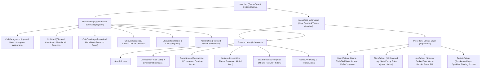
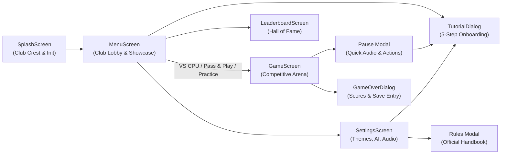

# 🎨 CARROM ZONE — COMPLETE UI/UX & DESIGN SYSTEM SPECIFICATION

> **Document Version:** 2.1.0 (Carrom Zone — Modern Minimal Dark Edition)  
> **Project:** Carrom Zone (formerly Carrom Master, Flutter / Dart)  
> **Design Identity:** Modern Minimal Dark Carrom Club — Deep Charcoal, Midnight Navy, Muted Heritage Teal, Natural Birch & Rosewood, Warm Ivory, and Restrained Champagne-Gold  
> **Rendering Engine:** 1080×1920 WebP Studio Backgrounds (`ClubBackgroundPreset`) + 100% Procedural Flutter `CustomPainter` Canvas + Centralized `ClubDesignSystem`  

---

## 📑 TABLE OF CONTENTS

1. [Design Philosophy & Art Direction](#1-design-philosophy--art-direction)
2. [UI/UX Architecture & File Structure](#2-uiux-architecture--file-structure)
3. [Complete Color Token System (`AppColors`)](#3-complete-color-token-system-appcolors)
   - 3.1 Primary Club Backgrounds (Deep Navy & Slate)
   - 3.2 Club Surface & Card Tokens
   - 3.3 Muted Heritage Teal & Natural Wood Accents
   - 3.4 Warm Ivory & Typography Hierarchy
   - 3.5 Brushed Brass & Gold Accents
   - 3.6 Board Theme Palettes (Birch, Teal, Navy)
   - 3.7 Carrom Coins, Striker & Pocket Tokens
   - 3.8 Semantic Status & Feedback Colors
4. [Typography & Visual Hierarchy (`ClubTypography`)](#4-typography--visual-hierarchy-clubtypography)
5. [Centralized Design System Components (`design_system.dart`)](#5-centralized-design-system-components-design_systemdart)
   - 5.1 `ClubBackground` & `_ClubBackdropPainter`
   - 5.2 `ClubCard` (Material-Safe Elevated Container)
   - 5.3 `ClubSectionHeader`
   - 5.4 `ClubCrestLogo` & `_ClubCrestPainter`
   - 5.5 `ClubCoinBadge` (3D Miniature Piece Widget)
   - 5.6 `ClubMotion` (Reduced-Motion & Accessibility Engine)
6. [Board Theme System (3 Signature Club Finishes)](#6-board-theme-system-3-signature-club-finishes)
   - 6.1 Theme 1: Classic Birch & Rosewood (`BoardThemeType.mahogany`)
   - 6.2 Theme 2: Heritage Club Teal (`BoardThemeType.emerald`)
   - 6.3 Theme 3: Royal Navy Lounge (`BoardThemeType.midnight`)
7. [Procedural Canvas Painters (Deep Dive)](#7-procedural-canvas-painters-deep-dive)
   - 7.1 `BoardPainter` (`lib/painters/board_painter.dart`)
   - 7.2 `PiecePainter` (`lib/painters/piece_painter.dart`)
   - 7.3 `AimPainter` (`lib/painters/aim_painter.dart`)
   - 7.4 `ParticlePainter` (`lib/painters/particle_painter.dart`)
8. [Screen-by-Screen UI/UX Specification & Flows](#8-screen-by-screen-uiux-specification--flows)
   - 8.1 Splash Screen (`splash_screen.dart`)
   - 8.2 Home / Club Lobby Screen (`menu_screen.dart`)
   - 8.3 Gameplay Arena & Competitive HUD (`game_screen.dart`)
   - 8.4 Pause Modal Dialog (`game_screen.dart`)
   - 8.5 Settings & Live Theme Preview Screen (`settings_screen.dart`)
   - 8.6 Club Rules Modal Dialog (`settings_screen.dart`)
   - 8.7 Hall of Fame Leaderboard Screen (`leaderboard_screen.dart`)
   - 8.8 Match Summary / Game Over Dialog (`game_over_dialog.dart`)
   - 8.9 Interactive 5-Step Tutorial Dialog (`tutorial_dialog.dart`)
9. [Animations, Micro-Interactions & Haptic UX Mapping](#9-animations-micro-interactions--haptic-ux-mapping)
10. [Responsive Layout, SafeArea & Viewport Mathematics](#10-responsive-layout-safearea--viewport-mathematics)

---

## 1. DESIGN PHILOSOPHY & ART DIRECTION

**Carrom Master** follows a **Modern Carrom Club** aesthetic designed to evoke the atmosphere of a prestigious championship tabletop lounge:

1. **Authentic Materiality over Neon Glow:** Instead of oversaturated casino neon colors or generic Material widgets, the interface combines **hand-rubbed rosewood and walnut**, **smooth natural birchwood**, **tournament muted teal baize**, **deep architectural navy**, and **brushed brass inlays**.
2. **Maximum Playable Surface Area:** On mobile portrait screens, the square Carrom board dynamically expands to occupy the maximum practical viewport width and height (`LayoutBuilder`), flanked by a compact competitive HUD above and an ergonomic baseline striker dock below.
3. **High-Contrast Visual Readability:** Every board surface, piece rim, and aiming trajectory dot is engineered with dual-layer contrast (e.g., shadow-backed trajectory dots and dark-rimmed ivory pieces) so gameplay remains crystal-clear on both light birchwood and dark teal/navy boards.
4. **Zero External Image Dependencies:** Every emblem, coin, woodgrain texture, pocket net, compass rose mandala, and particle burst is drawn mathematically via Flutter's hardware-accelerated `Canvas`, ensuring crisp rendering at any DPI and ultra-fast 60 FPS performance.

---

## 2. UI/UX ARCHITECTURE & FILE STRUCTURE

| File Path | UI/UX Responsibility |
| :--- | :--- |
| [`lib/main.dart`](file:///c:/Users/Entire/Downloads/carrom_zone/lib/main.dart) | Configures portrait lock, transparent status bar, `AppColors.bgDark` system nav bar, and global dark `ThemeData`. |
| [`lib/core/app_colors.dart`](file:///c:/Users/Entire/Downloads/carrom_zone/lib/core/app_colors.dart) | Master repository of all color constants, `BoardThemeType` enum, and theme metadata helpers. |
| [`lib/core/design_system.dart`](file:///c:/Users/Entire/Downloads/carrom_zone/lib/core/design_system.dart) | Reusable UI building blocks (`ClubBackground`, `ClubCard`, `ClubTypography`, `ClubMotion`, `ClubCrestLogo`, `ClubCoinBadge`). |
| [`lib/painters/board_painter.dart`](file:///c:/Users/Entire/Downloads/carrom_zone/lib/painters/board_painter.dart) | Renders the Carrom cabinet frame, brass corner L-plates, surface textures, baselines, diagonal arrows, pockets, and 12-point compass mandala. |
| [`lib/painters/piece_painter.dart`](file:///c:/Users/Entire/Downloads/carrom_zone/lib/painters/piece_painter.dart) | Renders 3D Carrom coins with lathe grooves, contact shadows, and the breathing-halo striker. |
| [`lib/painters/aim_painter.dart`](file:///c:/Users/Entire/Downloads/carrom_zone/lib/painters/aim_painter.dart) | Renders pull-back tension lines, shadow-backed trajectory dots, ghost striker impact reticle, radial power arc, and `%` pill badge. |
| [`lib/painters/particle_painter.dart`](file:///c:/Users/Entire/Downloads/carrom_zone/lib/painters/particle_painter.dart) | Renders pocket shockwaves, radial sparkle bursts, and rising floating score badges (`+1`, `👑 +3 QUEEN`, `FOUL -1`). |
| [`lib/screens/splash_screen.dart`](file:///c:/Users/Entire/Downloads/carrom_zone/lib/screens/splash_screen.dart) | Animated club crest intro, service initialization, and smooth fade transition to the main lobby. |
| [`lib/screens/menu_screen.dart`](file:///c:/Users/Entire/Downloads/carrom_zone/lib/screens/menu_screen.dart) | Main Club Lobby featuring live miniature board preview, quick theme switcher, game mode cards, and lounge navigation dock. |
| [`lib/screens/game_screen.dart`](file:///c:/Users/Entire/Downloads/carrom_zone/lib/screens/game_screen.dart) | Competitive HUD, queen/toast status banner, maximized square board viewport, baseline striker slider dock, and pause modal. |
| [`lib/screens/settings_screen.dart`](file:///c:/Users/Entire/Downloads/carrom_zone/lib/screens/settings_screen.dart) | Interactive miniature board theme cards, 3-bar AI difficulty selector, independent audio/haptic switches, and rules handbook. |
| [`lib/screens/leaderboard_screen.dart`](file:///c:/Users/Entire/Downloads/carrom_zone/lib/screens/leaderboard_screen.dart) | Segmented mode filter bar, Top-3 Hall of Fame podium pillars, ranked player cards, and reset confirmation modal. |
| [`lib/screens/game_over_dialog.dart`](file:///c:/Users/Entire/Downloads/carrom_zone/lib/screens/game_over_dialog.dart) | Victory/defeat medallion, side-by-side player score cards, leaderboard name entry, and rematch/menu actions. |
| [`lib/screens/tutorial_dialog.dart`](file:///c:/Users/Entire/Downloads/carrom_zone/lib/screens/tutorial_dialog.dart) | Interactive 5-step paginated onboarding guide with step badges, dot indicators, and `"Don't show again"` persistence. |

---

## 3. COMPLETE COLOR TOKEN SYSTEM (`AppColors`)

All colors are centrally defined in [`lib/core/app_colors.dart`](file:///c:/Users/Entire/Downloads/carrom_zone/lib/core/app_colors.dart).

### 3.1 Primary Club Backgrounds (Deep Navy & Slate)
| Token Name | Hex Code | ARGB Value | Usage |
| :--- | :--- | :--- | :--- |
| `bgDark` | `#0A121E` | `0xFF0A121E` | Primary scaffold background, input field fills, recessed track backgrounds |
| `bgGradientTop` | `#132238` | `0xFF132238` | Top stop of `ClubBackground` linear gradient |
| `bgGradientMid` | `#0E1A2B` | `0xFF0E1A2B` | Middle stop (55%) of `ClubBackground` linear gradient |
| `bgGradientBottom` | `#080E18` | `0xFF080E18` | Bottom stop (100%) of `ClubBackground` linear gradient |

### 3.2 Club Surface & Card Tokens
| Token Name | Hex Code | ARGB Value | Usage |
| :--- | :--- | :--- | :--- |
| `cardBg` | `#132033` | `0xFF132033` | Standard `ClubCard`, dialog containers, inactive HUD player badges, bottom dock |
| `cardBgLight` | `#1A2B44` | `0xFF1A2B44` | Secondary mode card gradient top, pause action tiles, Top-3 leaderboard rows |
| `cardBgElevated` | `#213552` | `0xFF213552` | Active turn HUD player card, active theme pill, toast notification pill |
| `cardBgGlass` | `#132033` (90%) | `0xE6132033` | Translucent overlay surfaces |
| `cardBorder` | `#293F5F` | `0xFF293F5F` | Primary 1.2px border for cards, icon buttons, and segmented controls |
| `cardBorderSubtle` | `#1E304A` | `0xFF1E304A` | Subtle internal dividers, unselected chips, nudge button borders |

### 3.3 Muted Heritage Teal & Natural Wood Accents
| Token Name | Hex Code | ARGB Value | Usage |
| :--- | :--- | :--- | :--- |
| `tealPrimary` | `#1F6E66` | `0xFF1F6E66` | Primary club accent, striker compass star, active turn pill fill, save button |
| `tealLight` | `#2E9489` | `0xFF2E9489` | VS CPU mode card accent, tutorial icons, SFX icon tint, Emerald theme accent |
| `tealDark` | `#134640` | `0xFF134640` | Deep teal shading |
| `tealSurface` | `#163836` | `0xFF163836` | Primary VS CPU card gradient top, splash badge pill background |
| `woodLight` | `#8C5332` | `0xFF8C5332` | Warm rosewood/walnut highlight |
| `woodPrimary` | `#5C321C` | `0xFF5C321C` | Club crest diamond board frame |
| `woodDark` | `#361B0E` | `0xFF361B0E` | Striker outer rim contrast stroke |
| `woodDeep` | `#221008` | `0xFF221008` | Deep cabinet shadow |

### 3.4 Warm Ivory & Typography Hierarchy
| Token Name | Hex Code | ARGB Value | Usage |
| :--- | :--- | :--- | :--- |
| `ivory` | `#F6F1E7` | `0xFFF6F1E7` | Primary display titles, active player names, slider thumb, board markings |
| `ivoryWarm` | `#EBDDC8` | `0xFFEBDDC8` | Header icon tints, splash badge text |
| `ivoryMuted` | `#D5C3A6` | `0xFFD5C3A6` | Muted warm accents |
| `textPrimary` | `#F7F4EE` | `0xFFF7F4EE` | Primary body titles, list tile titles, scores |
| `textSecondary` | `#B4C2D4` | `0xFFB4C2D4` | Subtitles, descriptions, inactive player labels |
| `textMuted` | `#7A8CA3` | `0xFF7A8CA3` | Captions, table headers, disabled icons, remaining coin counters |

### 3.5 Subtle Brushed Brass & Gold Accents
| Token Name | Hex Code | ARGB Value | Usage |
| :--- | :--- | :--- | :--- |
| `gold` | `#D4AF37` | `0xFFD4AF37` | Primary CTA buttons (`RESUME`, `REMATCH`, `NEXT`), active card borders, slider track |
| `goldBright` | `#E6C665` | `0xFFE6C665` | 1st place trophies, active turn scores, winner highlights |
| `goldLight` | `#F2DFA0` | `0xFFF2DFA0` | Section labels, pause button icon, frame inlay highlights |
| `goldDark` | `#9A7B2C` | `0xFF9A7B2C` | Pocket outer brass collars, metallic gradient shadows |
| `goldDeep` | `#6E551A` | `0xFF6E551A` | Deep brass shadow |
| `dividerGold` | `#D4AF37` (20%) | `0x33D4AF37` | Subtle gold divider line |

### 3.6 Board Theme Palettes (`mahogany`, `emerald`, `midnight`)
| Theme Enum | Display Name | Surface Light | Surface Mid | Surface Dark | Frame Gradient Stops |
| :--- | :--- | :--- | :--- | :--- | :--- |
| `BoardThemeType.mahogany` | **Classic Birch & Rosewood** | `#F4E6CC` | `#E8D3B0` | `#D4B98E` | `#542B18` → `#3E1E10` → `#2C140A` → `#1E0D06` |
| `BoardThemeType.emerald` | **Heritage Club Teal** | `#256B63` | `#1B524C` | `#113834` | `#472918` → `#331C10` → `#24130A` → `#180C06` |
| `BoardThemeType.midnight` | **Royal Navy Lounge** | `#22334E` | `#182438` | `#0E1624` | `#243146` → `#182232` → `#111824` → `#0B1018` |

### 3.7 Carrom Coins, Striker & Pocket Tokens
| Token Name | Hex Code | Visual Role |
| :--- | :--- | :--- |
| `whitePiece` | `#FAF6EE` | Warm boxwood/ivory White Carrom coin body |
| `whitePieceRing` | `#C9B99F` | Concentric lathe ring on White coin |
| `blackPiece` | `#1E2229` | Deep slate ebony Black Carrom coin body |
| `blackPieceRing` | `#434B57` | Concentric lathe ring on Black coin |
| `queenPiece` | `#D92638` | Tournament ruby crimson Queen coin body & center pip |
| `queenPieceRing` | `#9E1926` | Deep ruby ring on Queen coin |
| `strikerBody` | `#FCF8F0` | Pearl acrylic striker base |
| `pocketHole` | `#090C10` | Deep corner pocket cavity |
| `pocketRing` | `#2C1910` | Hardwood/leather pocket collar bezel |
| `boardLineDark` | `#2B1D16` | Espresso charcoal markings on the light Birchwood board |
| `boardCrimson` | `#C83232` | Tournament crimson baseline circles & primary compass petals |

### 3.8 Semantic Status & Feedback Colors
| Token Name | Hex Code | Visual Role |
| :--- | :--- | :--- |
| `accentGreen` | `#2EC486` | Low/control power aim (`< 38%`), Queen covered badge, Easy AI bar, turn pot toast |
| `accentAmber` | `#F5A623` | Medium power aim (`38%–76%`), opponent coin pocketed toast |
| `accentRed` | `#E5484D` | High/max power aim (`> 76%`), striker foul warning, Hard AI bar, Quit/Clear actions |
| `accentBlue` | `#4B96F3` | CPU thinking indicator, Practice Arena accent, Midnight theme accent, Restart action |

---

## 4. TYPOGRAPHY & VISUAL HIERARCHY (`ClubTypography`)

Defined in [`lib/core/design_system.dart`](file:///c:/Users/Entire/Downloads/carrom_zone/lib/core/design_system.dart), the typography system pairs two Google Fonts families:

1. **`GoogleFonts.cinzel` (Display & Club Prestige Headers):**
   - Engraved serif used strictly for screen titles, modal headers, and championship branding.
2. **`GoogleFonts.outfit` (UI Controls, HUD & Tabular Numerals):**
   - Clean geometric sans-serif used for all cards, subtitles, badges, rules prose, and tabular score counters (`FontFeature.tabularFigures()`).

| Style Method / Usage | Font Family | Size | Weight | Letter Spacing | Color |
| :--- | :--- | :--- | :--- | :--- | :--- |
| `ClubTypography.displayLarge` | `Cinzel` | `30px` | `w700` (Bold) | `3.0` | `AppColors.ivory` |
| `ClubTypography.displayMedium` | `Cinzel` | `22px` | `w700` (Bold) | `2.2` | `AppColors.ivory` |
| `ClubTypography.sectionLabel` | `Outfit` | `11px` | `w700` (Bold) | `1.8` | `AppColors.goldLight` |
| `ClubTypography.cardTitle` | `Outfit` | `16px` | `w700` (Bold) | `0.4` | `AppColors.textPrimary` |
| `ClubTypography.body` | `Outfit` | `13px` | `w400` (Regular) | `0.0` | `AppColors.textSecondary` |
| `ClubTypography.scoreNumber` | `Outfit` | `20px–26px` | `w800` (ExtraBold) | Tabular Figures | `AppColors.ivory` / `goldBright` |

---

## 5. CENTRALIZED DESIGN SYSTEM COMPONENTS (`design_system.dart`)

### 5.1 `ClubBackground` & `_ClubBackdropPainter`
- Renders the full-screen 3-stop vertical navy gradient (`bgGradientTop` → `bgGradientMid` → `bgGradientBottom`).
- When `showWatermark: true` (on Splash, Menu, Settings, Leaderboard), `_ClubBackdropPainter` draws:
  - A soft radial ambient light at `(width * 0.5, height * 0.14)` tinted by the active theme's accent color (`accentTint.withOpacity(0.14)`).
  - Concentric subtle Carrom compass rings (`ivory.withOpacity(0.028)`) and a 14px inset rounded-rectangle club framing border (`gold.withOpacity(0.05)`).
- On `GameScreen`, `showWatermark` is set to `false` so 100% of GPU canvas time is dedicated to the 60 FPS board and physics loop.

### 5.2 `ClubCard`
- Standard elevated container with `18px` border radius, `1.2px` border (`AppColors.cardBorder`), `AppColors.cardBg` fill, and a soft `14px` blur drop shadow (`Offset(0, 6)`).
- Wraps its child in `Material(type: MaterialType.transparency)` so descendant `InkWell`, `ListTile`, and `SwitchListTile` widgets render ink splashes cleanly without framework assertions.

### 5.3 `ClubSectionHeader`
- Displays a `3.5px × 14px` vertical brushed-gold accent bar (`AppColors.gold`) beside an uppercase tracked label (`11px`, `letterSpacing: 1.8`), with an optional right-aligned `trailingText` metadata label (e.g., `AI: MEDIUM`, `Live Preview`).

### 5.4 `ClubCrestLogo`
- A custom-painted circular medallion (`_ClubCrestPainter`) used on the Splash Screen (`112px`) and Home Header (`46px`).
- Draws a brushed brass outer ring, a deep navy inner shield, a $45^\circ$ rotated diamond Carrom board in rosewood & birchwood, 4 corner pockets, and a central ruby Queen jewel with a specular highlight.

### 5.5 `ClubCoinBadge`
- Renders a 3D miniature Carrom piece (`White`, `Black`, or `Queen`) with an off-center `RadialGradient` (`Alignment(-0.3, -0.3)`), outer bevel border, inner lathe ring, and drop shadow.
- Used in the Gameplay HUD player scorecards and the Game Over score comparison cards.

### 5.6 `ClubMotion` (Reduced-Motion Accessibility)
- Inspects `MediaQuery.maybeOf(context)?.disableAnimations ?? false`.
- Automatically disables looping floating/breathing animations, button scale-down effects, and page transition durations when the user's OS has Reduced Motion enabled.

---

## 6. BOARD THEME SYSTEM (3 SIGNATURE CLUB FINISHES)

Players can switch themes either from the **Settings Screen** or directly from the **Home Screen Showcase Card** (`Birch`, `Teal`, `Navy` quick pills).

### 6.1 Classic Birch & Rosewood (`BoardThemeType.mahogany` — Default)
- **Visual Identity:** Authentic tournament Carrom board.
- **Playing Surface:** Warm, light natural Birchwood (`#F4E6CC` → `#E8D3B0` → `#D4B98E`) with fine sinusoidal horizontal woodgrain striations.
- **Outer Cabinet Frame:** Deep hand-rubbed Rosewood (`#542B18` → `#1E0D06`) with brushed brass inner cushion trim and corner brass L-plates.
- **Markings:** High-contrast espresso charcoal (`#2B1D16`) lines paired with tournament crimson (`#C83232`) baseline circles and compass rose petals.

### 6.2 Heritage Club Teal (`BoardThemeType.emerald`)
- **Visual Identity:** Prestigious English club baize table.
- **Playing Surface:** Muted heritage teal (`#256B63` → `#1B524C` → `#113834`) with a fine crosshatch woven baize texture.
- **Outer Cabinet Frame:** Warm Walnut hardwood (`#472918` → `#180C06`) with brushed brass trim.
- **Markings:** Champagne gold (`#F2DFA0`) and brushed gold lines with crimson accents.

### 6.3 Royal Navy Lounge (`BoardThemeType.midnight`)
- **Visual Identity:** Contemporary architectural evening lounge.
- **Playing Surface:** Deep navy slate (`#22334E` → `#182438` → `#0E1624`) with subtle concentric architectural guide rings.
- **Outer Cabinet Frame:** Espresso ebony & slate (`#243146` → `#0B1018`) with champagne gold trim.
- **Markings:** Crisp champagne gold (`#F2DFA0`) and crimson geometric inlays.

---

## 7. PROCEDURAL CANVAS PAINTERS (DEEP DIVE)

All gameplay painters normalize coordinates to the virtual board space ($400 \times 400$ playing field + $35 \times 2$ frame width = $470 \times 470$ total virtual units, with $(0,0)$ at the center):
$$\text{scale} = \frac{\text{canvasWidth}}{470.0}$$

### 7.1 `BoardPainter` (`lib/painters/board_painter.dart`)
Executes a 10-stage rendering pipeline wrapped in a `RepaintBoundary` (only repaints if `theme` changes):
1. **Outer Cabinet Frame (`_drawOuterFrame`):** Draws drop shadow, protective dark rim, 4-stop hardwood gradient cabinet (`R = 18`), inner chamfer ring, and `3.0px` brushed brass cushion inlay bezel.
2. **Surface Illumination (`_drawSurface`):** Off-center `RadialGradient` (`Alignment(-0.1, -0.1)`) simulating overhead club table lighting.
3. **Material Texture (`_drawThemeTexture`):** Sinusoidal birchwood grain (`mahogany`), orthogonal baize weave (`emerald`), or concentric architectural rings (`midnight`).
4. **Cushion Shadows (`_drawCushionShadows`):** $11.0\text{ unit}$ inward linear gradient shadows along all 4 rails for recessed depth.
5. **Outer Boundary (`_drawBoundaries`):** Crisp framing rectangle inside the cushions.
6. **Double Baselines (`_drawBaselines`):** Top, bottom, left, and right double-track baselines ($Y, X = \pm 142.0$, half-width $85.0$) with $R = 13.5$ tournament crimson end-circles, ivory inner rings, and center pips.
7. **Diagonal Foul Arrows (`_drawDiagonalArrows`):** 4 diagonal shafts from $(\pm 60, \pm 60)$ to $(\pm 152, \pm 152)$ with tournament semicircular arcs ($R = 18.0$), precision arrowheads pointing into the corner pockets, and tail fletching rings.
8. **12-Point Compass Rose Mandala (`_drawCenterMandala`):**
   - Outer tournament circle ($R = 74$) & secondary ring ($R = 70$).
   - 12 geometric compass petals alternating between tournament crimson and primary line color ($R_{\text{inner}} = 22$, $R_{\text{outer}} = 67$).
   - Mid ring ($R = 46$) and central Queen circle ($R = 16$) with crimson fill and ivory/gold concentric rings.
9. **Corner Pockets (`_drawPockets`):** Positioned at $(\pm 178, \pm 178)$ with $R = 19.0$. Draws outer brass collar, hardwood bezel, dark cavity, clipped woven cord netting crosshatch, 3D inner sink shadow, and top-left rim highlight arc.
10. **Corner Club Plates (`_drawCornerClubPlates`):** Clean geometric brass L-joint brackets with 3 brass rivets in each frame corner.

### 7.2 `PiecePainter` (`lib/painters/piece_painter.dart`)
- **Pocket Shrink Animation:** Scales radius and opacity by $\text{shrink} = (1.0 - \text{pocketProgress})\text{ clamped to } [0, 1]$.
- **White Piece (`_drawWhitePiece`):** 4-stop warm boxwood ivory radial gradient + **`#6E5A44` outer contrast rim** (so white pieces pop sharply against the light birchwood surface) + 2 concentric lathe grooves + center dimple + top-left specular highlight.
- **Black Piece (`_drawBlackPiece`):** 4-stop slate ebony radial gradient + **`#606A7A` subtle outer rim** (so black pieces pop against dark teal/navy boards) + concentric lathe grooves + specular sheen.
- **Queen Piece (`_drawQueenPiece`):** 4-stop ruby crimson radial gradient + brushed gold outer inlay + 8-point rosette star + center ivory pip.
- **Striker (`_drawStriker`):**
  - Subtle breathing gold halo (`strikerGlowPhase`) with `4.5px` blur.
  - Pearl ivory acrylic body + dark wood outer rim + brushed brass ring + muted teal inner ring + **8-point teal compass star** + crimson/gold center jewel.

### 7.3 `AimPainter` (`lib/painters/aim_painter.dart`)
Active only when `_stateMachine.isAiming`:
- **Dynamic Power Color:**
  - $0\%–38\%$: `AppColors.accentGreen` (`#2EC486` — Control)
  - $38\%–76\%$: `AppColors.accentAmber` (`#F5A623` — Medium)
  - $76\%–100\%$: `AppColors.accentRed` (`#E5484D` — High Power)
- **Pull-Back Tension Line:** Dark-outlined line extending behind the striker in the finger drag direction.
- **Shadow-Backed Trajectory Dots:** Tapered guide dots extending forward up to $92 + 155 \times \text{power}$ units. Each dot is drawn over a dark halo (`Colors.black.withOpacity(0.45)`) so it remains 100% visible on both light birchwood and dark boards.
- **Ghost Striker Impact Reticle:** Draws a translucent circle of exact `strikerRadius` ($16.0$) with a precision crosshair at the trajectory tip.
- **Radial Power Gauge & Pill Badge:** Draws a $360^\circ$ sweep arc around the striker and a dark navy pill badge (`#D90D1624`) bordered in `aimColor` displaying the exact power percentage (`75%`).

### 7.4 `ParticlePainter` (`lib/painters/particle_painter.dart`)
- **Expanding Shockwave Rings (`PocketRingEffect`):** Expands from $R = 10$ to $R = 56$ units with tapering stroke width.
- **Sparkle Burst (`PocketParticle`):** 14 radial particles bursting outward from the pocket center on every pot.
- **Floating Score Badges (`FloatingScoreEffect`):** Rises $30\text{ units}$ upward while fading out, displaying `+1`, `👑 +3 QUEEN`, `OPPONENT`, or `FOUL -1`.

---

## 8. SCREEN-BY-SCREEN UI/UX SPECIFICATION & FLOWS

### 8.1 Splash Screen (`splash_screen.dart`)
- **Background Preset:** `ClubBackgroundPreset.splash` (`assets/images/backgrounds/splash_bg.webp`, 1080×1920 WebP, 42.3 KB) — Cinematic macro close-up of an authentic wooden Carrom board in the lower third with deep midnight-navy negative space above.
- **Visual Layout:** Upper negative space holds `ClubCrestLogo(size: 108)`, `CARROM ZONE` display title, and `PLAY • COMPETE • MASTER` champagne-gold tagline; bottom frame displays a `160px` brushed-gold `LinearProgressIndicator` (`LOADING...`). Pre-caches all 4 WebP backgrounds via `ClubBackground.precacheAll(context)`.
- **Animation:** `1200ms` `easeOutCubic` scale (`0.90` → `1.0`) and fade-in, followed by a `500ms` fade transition into `MenuScreen`.

### 8.2 Home / Club Lobby Screen (`menu_screen.dart`)
- **Background Preset:** `ClubBackgroundPreset.home` (`assets/images/backgrounds/home_bg.webp`, 1080×1920 WebP, 45.0 KB) — Perspective wooden Carrom board on the middle-right with generous dark negative space for UI controls.
- **Constrained Responsive Width:** Max width `460px` centered inside `SafeArea` + `SingleChildScrollView`.
- **1. Top Club Header:** `ClubCrestLogo(size: 46)`, `CARROM ZONE` title, live status dot (`GOOD PLAYERS • BETTER GAMES`), and `42×42` quick action buttons for **How to Play** and **Settings**.
- **2. Interactive Board Showcase Card:**
  - Left: `118×118` live custom-painted Carrom board (`BoardPainter` + `PiecePainter`) with gentle sinusoidal floating motion (`±2.2px`).
  - Right: `ACTIVE TABLE FINISH` gold pill, active theme title & description, and **3 interactive quick-switcher pills** (`Birch`, `Teal`, `Navy`) that immediately update and persist the board finish.
- **3. Game Mode Cards (`SELECT GAME MODE`):**
  - Displays current AI level in section trailing text (`AI: MEDIUM`).
  - **VS CPU (`1P MATCH`):** Primary highlighted card with `tealSurface` → `cardBgLight` gradient, `tealLight` border, robot icon medallion, and solid gold play button.
  - **PASS & PLAY (`2 PLAYERS`):** Gold & rosewood accented card for local 2-player tabletop matches.
  - **PRACTICE ARENA (`TRAINING`):** Slate-blue accented card for solo trick-shot and angle practice.
- **4. Club Lounge Dock (`CLUB LOUNGE`):**
  - 2-column row for **LEADERBOARD** (`Hall of Fame`) and **HOW TO PLAY** (`Club Rules`), plus a full-width banner tile for **SETTINGS & THEMES**.

### 8.3 Gameplay Arena & Competitive HUD (`game_screen.dart`)
- **1. Competitive Top Scoreboard (`_buildTopScoreboard`):**
  - **Left & Right Player Cards (`_playerBadge`):** Displays `ClubCoinBadge` (3D White or Black coin), player name (`You (White)` vs `CPU (Black)` / `Player 2` / `Target`), bold tabular score (`$score pts`), and remaining coin count (`• $remaining left`). Active player's card illuminates with `AppColors.cardBgElevated`, a `1.6px` `AppColors.gold` border, and soft gold elevation shadow.
  - **Center Match Control:** `38×38` Pause button (`Icons.pause_circle_filled_rounded`) above a dynamic turn pill (`YOUR TURN`, `CPU TURN`, or `P2 TURN`).
- **2. Status & Queen Banner (`_buildStatusBanner`):**
  - Left: Persistent Queen status pill (`👑 Queen in Play` in gold, `👑 Queen Pocketed • Must Cover!` in crimson, or `👑 Queen Covered! (+3)` in emerald green).
  - Right: Animated toast notification pill (`_toastMessage`) for turn feedback, fouls, and covers.
- **3. Maximized Square Board Viewport:**
  - Uses `Expanded` + `LayoutBuilder` to compute `maxBoardDim = max(120, min(availWidth - 16, availHeight - 8))`, ensuring the largest possible undistorted $1:1$ square board.
- **4. Bottom Striker Control Dock (`_buildBottomControls`):**
  - Styled as an elevated `ClubCard` dock at the bottom of the screen:
    - **Top Status Row:** `STRIKER POSITION` label on the left; live contextual hint or real-time **`POWER XX% • Release to shoot`** readout on the right.
    - **Baseline Track & Micro-Nudge Row:** Left (`◀`) and Right (`▶`) `36×36` micro-nudge buttons (`±3.5` virtual units per tap with light haptic feedback) flanking a recessed baseline slider track adorned with crimson baseline end-circles. Turns red (`AppColors.accentRed`) if the striker overlaps a board piece.

### 8.4 Pause Modal Dialog (`game_screen.dart`)
- Triggered by the HUD pause button or app lifecycle backgrounding.
- Features a pause medallion header (`GAME PAUSED`), an embedded toggle card for **Sound Effects (SFX)**, **Background Music**, and **Haptic Vibration**, action tiles for **How to Play / Rules**, **Restart Match**, and **Quit to Menu**, and a full-width gold **RESUME** button.

### 8.5 Settings & Live Theme Preview Screen (`settings_screen.dart`)
- **1. Board Themes (`BOARD THEMES`):** 3 interactive cards (`Mahogany / Birch & Wood`, `Emerald / Club Teal`, `Midnight / Navy Lounge`), each rendering a live `52×52` `BoardPainter` miniature preview, plus a bottom description banner explaining the selected surface material.
- **2. AI Difficulty (`AI DIFFICULTY`):** 3 interactive cards (`Easy`, `Medium`, `Hard`) with **visual ascending skill bars** (1, 2, or 3 lit bars) and color-coded borders (`accentGreen`, `gold`, `accentRed`).
- **3. Audio & Haptics (`AUDIO & HAPTICS`):** Grouped `SwitchListTile` rows with tinted icon badges for SFX, BGM, and Haptics.
- **4. Club Handbook (`CLUB HANDBOOK`):** Launchers for the `Interactive Beginner Tutorial` and `Official Carrom Rules` modal.

### 8.6 Hall of Fame Leaderboard Screen (`leaderboard_screen.dart`)
- **Segmented Filter Control:** Pill bar filtering records by `ALL`, `VS CPU`, or `PASS & PLAY`.
- **Top-3 Podium (`_buildPodium`):** Displayed when $\ge 3$ entries exist; renders #2 Silver (`66px`), #1 Gold (`86px` with trophy icon), and #3 Bronze (`54px`) podium pillars.
- **Ranked List & Empty State:** Displays rank badge (`#1`, `#2`, ...), player name, win count & date, mode pill badge, and tabular score. Includes a confirmation modal (`Reset Leaderboard?`) before clearing records.

### 8.7 Match Summary / Game Over Dialog (`game_over_dialog.dart`)
- Displays trophy/medallion header, dynamic outcome title (`YOU WIN!`, `CPU WINS!`, `Player 1 (White) WINS!`, or `PRACTICE FINISHED!`), side-by-side `_scoreCard` widgets with `ClubCoinBadge`, an inline `TextField` + `SAVE` button for recording winning scores to the Leaderboard, and `MAIN MENU` / `REMATCH` buttons.

### 8.8 Interactive 5-Step Tutorial Dialog (`tutorial_dialog.dart`)
- Paginated `PageView` modal (`HOW TO PLAY`) covering:
  1. **Aim & Flick** (`STEP 1 • BASIC CONTROL`)
  2. **Striker Positioning** (`STEP 2 • PLACEMENT`)
  3. **Turn Continuation** (`STEP 3 • GAMEPLAY`)
  4. **The Red Queen** (`STEP 4 • ROYAL RULE`)
  5. **Fouls & Penalties** (`STEP 5 • PENALTY`)
- Includes animated pagination dots, a `"Don't show again"` checkbox persisted via `StorageService`, and a `NEXT` / `LET'S PLAY` CTA button.

---

## 9. ANIMATIONS, MICRO-INTERACTIONS & HAPTIC UX MAPPING

| Interaction / Event | Visual Animation | Audio Trigger | Haptic Feedback |
| :--- | :--- | :--- | :--- |
| **Button / Card Press** | `AnimatedScale` (`1.0` → `0.97` over `100ms`) | — | `hapticSelection()` |
| **Screen Navigation** | `FadeTransition` (`350ms–500ms`) | — | `hapticSelection()` |
| **Striker Micro-Nudge (`◀`/`▶`)** | Instant baseline coordinate step (`±3.5u`) | — | `hapticLight()` |
| **Start Aiming Drag** | Radial power ring & trajectory dots appear | — | `hapticLight()` |
| **Release Striker Shot** | Striker impulse velocity launched | `playShoot()` | `hapticMedium()` |
| **Piece-to-Piece Impact** | Physics impulse separation | `playHit()` (`impulse > 0.8`) | — |
| **Cushion Rebound** | Velocity reflection off rail | `playWall()` | — |
| **Piece / Queen Pocketed** | Shrink-to-pocket + 14 sparks + shockwave + floating score | `playPocket()` | `hapticHeavy()` |
| **Match Victory** | `GameOverDialog` entrance | `playWin()` | `hapticCelebration()` |

---

## 10. RESPONSIVE LAYOUT, SAFEAREA & VIEWPORT MATHEMATICS

1. **Adaptive Square Board Sizing (`GameScreen`):**
   $$\text{BoardSize}_{\text{px}} = \max\Big(120.0,\ \min(\text{AvailableWidth} - 16.0,\ \text{AvailableHeight} - 8.0)\Big)$$
   - Guarantees the Carrom board never distorts its $1:1$ square aspect ratio while filling maximum screen real estate on compact phones (`320×568`), tall modern phones (`412×915`), and tablets.
2. **Overflow-Proof Flex Hierarchy:**
   - Every horizontal `Row` containing dynamic text (player names, scores, remaining piece counts, mode badges, toast alerts, slider hints) wraps text children in `Flexible` or `Expanded` with `TextOverflow.ellipsis`.
   - Verified via automated widget tests down to compact `360×680` viewports with zero `RenderFlex` overflows.
3. **Tablet & Large-Screen Centering:**
   - Non-gameplay screens (`MenuScreen`, `SettingsScreen`, `LeaderboardScreen`) constrain content to `BoxConstraints(maxWidth: 460)` centered within `SafeArea`, preventing stretched buttons on wide screens.

